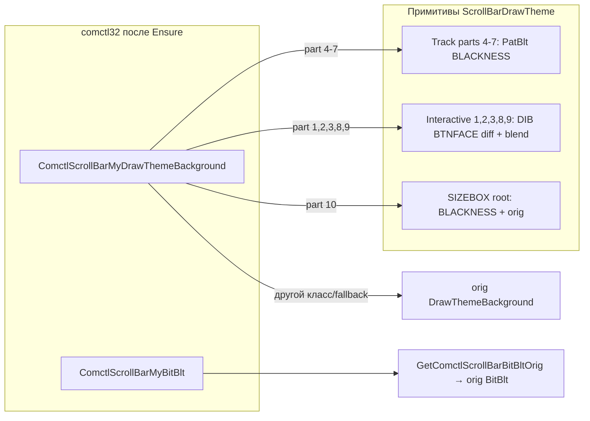

# Отрисовка скролл-бара в GlassProject

Документ описывает актуальную схему отрисовки `ScrollBar` после отказа от централизованного `ProcessDrawThemeBackground`.

---

## 1. Где теперь находится политика

`ScrollBarDrawTheme` больше не «роутер» по part/state.  
Он содержит только общие примитивы:

- `IsScrollBarTrackBackgroundPart()`
- `IsScrollBarInteractivePart()`
- `TryGetScrollBarDrawRect()`
- `TryDrawScrollBarInteractiveGlass()`
- `DrawScrollBarSizeBoxBlackThenOrig()`
- `LogScrollBarDrawThemeCall()`

Политика «что делать для конкретного `part/state`» теперь в хуках конкретных контролов:

- `ScrollBarThemeHooks.cpp` (`ComctlScrollBarMyDrawThemeBackground`)
- `ListViewHooks.cpp`
- `TreeViewHooks.cpp`
- `ListBoxHooks.cpp`
- `ComboLBoxHooks.cpp`
- `ComboBoxControlHooks.cpp`
- `DropDownHooks.cpp`

---

## 2. Текущие правила по частям

### 2.1. Дорожки (`part` 4..7)
- Всегда `PatBlt(..., BLACKNESS)` в клипе.

### 2.2. Интерактив (`part` 1,2,3,8,9)
- `TryDrawScrollBarInteractiveGlass()`:
  - два 32bpp DIB;
  - baseline = `COLOR_BTNFACE`;
  - rendered = `COLOR_BTNFACE` + `orig(DrawThemeBackground)`;
  - `ApplyDiffMask32` + `GdiAlphaBlend`.

### 2.3. Угол (`SBP_SIZEBOX`, `part` 10)
- **Root/comctl32 путь (`ScrollBarThemeHooks`)**: `BLACKNESS` + `orig` поверх (`DrawScrollBarSizeBoxBlackThenOrig`).
- **Вложенные контролы (`ListView/TreeView/...`)**: `BLACKNESS` (без `orig`) в их DTB-ветках `ScrollBar`.

Отдельно: в `ListView` и `TreeView` угол может приходить не через DTB(`part=10`), а через `FillRect(COLOR_BTNFACE)` в COMCTL32. Для этого есть отдельный `FillRect`-кейс по квадрату размера полосы прокрутки.

---

## 3. Маска фона (текущий тест)

В `ScrollBarDrawTheme.cpp` в `ApplyDiffMask32` добавлен тестовый допуск к фону:

- `kBgColorTolerance = 8`
- `effectiveDelta = max(delta - kBgColorTolerance, 0)`
- alpha строится от `effectiveDelta`, а не от сырого `delta`.

Это снижает чувствительность маски к небольшим отклонениям от `COLOR_BTNFACE`.

---

## 4. FillRect-путь для угла в ListView/TreeView

Для `ListView` и `TreeView` добавлена специальная обработка `FillRect`:

- проверка `LOGBRUSH` (`BS_SOLID`);
- цвет кисти близок к `COLOR_BTNFACE` (строгий `COLOR_BTNFACE` в текущей версии);
- прямоугольник квадратный;
- сторона равна ширине полосы прокрутки (с допуском `±1`).

Размер полосы берется через DPI-aware кэш:

- `GetSystemMetricsForDpi(SM_CXVSCROLL / SM_CYHSCROLL)` при `dpi != 96`;
- fallback на `GetSystemMetrics` при необходимости;
- thread-local кэш `dpi -> bandSize`.

Хук `FillRect` включается для обоих comctl:

- `g_comctl32New`
- `g_comctl32Legacy`

---

## 5. Установка IAT на comctl32

Установка **не** при загрузке процесса, а **лениво** при первом подходящем вызове. **Два триггера** (один и тот же `EnsureComctlScrollBarIatIfComctlCaller`):

| Триггер | Где в коде | Типичный `HWND` | Типичный caller (`DetourGetContainingModule`) |
|--------|------------|-----------------|--------------------------------------------------|
| **`HookBeginPaint` → `onBegin`** | `TreeViewHooks` / `ListViewHooks` / `ComboLBoxHooks` (`OnPaintBeginGlobal`, у ComboLBox также hot/scroll + PrintClient) | **SysTreeView32** / **SysListView32** / **ComboLBox** | **comctl32** (возврат из цепочки `BeginPaint` / аналог) |
| **`HookGetDCEx`** | `PaintDispatcher::HookGetDCEx` | окно из `GetDCEx` (иногда родитель, напр. **CabinetWClass**) | **comctl32** или **uxtheme** |

**Важно:** `onBegin` у paint-провайдеров вызывается **до** оригинального `BeginPaint` (`PaintDispatcher.cpp`), поэтому IAT на comctl32 для дерева/списка может установиться **до** первой отрисовки после входа в `WM_PAINT`. **`GetDCEx`** подстраховывает цепочку темизации, когда возврат лежит в **uxtheme** и/или `HWND` в вызове не совпадает с **SysTreeView32**.

Общие условия **`Ensure`** (выполняются для обоих триггеров):

1. **Caller:** базовое имя образа **`comctl32.dll`** или **`uxtheme.dll`** (и согласованные варианты — см. `ScrollBarThemeHooks.cpp`).
2. **HWND:** `ScrollBarTheme::ShouldInstallScrollBarIatForHwnd(hWnd)` — **`GlassIsComctlScrollHost(hwnd)`** (второй prop, см. ниже) **или** whitelist **`GlassGetWindowKind`** (ListView, TreeView, ComboLBox, DirectUI, NetUI, WinForms и др. — см. `ScrollBarThemeHooks.cpp`).

Дополнительно **`GlassShared::GlassMarkComctlScrollHost`** выставляется в **`Root_Attach`** только при **`InjectionMode::Full`**, после успешного `SetWindowSubclass`, с отсевом классов (**`ComboBoxEx32`**, **`Shell_TrayWnd`**, **`Shell_SecondaryTrayWnd`**, список расширяемый в `RootSubclass.cpp`). Снятие: **`GlassClearComctlScrollHost`** рядом с **`GlassUnmarkWindow`** (detach / `WM_GLASS_DETACH_ROOT` / `WM_NCDESTROY`).

При **выгрузке** экземпляра comctl32 **`ModuleHandler`** вызывает **`ScrollBarTheme::OnComctl32ModuleUnload`**. При shutdown ядра — **`ScrollBarTheme::ShutdownComctlScrollBarIat`** (в т.ч. из **`ScrollBar::Shutdown`**).

**BitBlt:** `ComctlScrollBarMyBitBlt` разрешает **`orig`** через **`ScrollBarTheme::GetComctlScrollBarBitBltOrig`** (обход стека + карта `g_comctlScrollBarMap`).

---

## 6. `DrawThemeOrigCallDepth` и ListView

Внутри **`TryDrawScrollBarInteractiveGlass`** (и при `ForwardToOrigWithDepth`) вызов настоящей темы **`orig`** на memory-DC оборачивается в **`ScrollBarTheme::DrawThemeOrigCallDepth`**.

Это увеличивает **thread-local** счётчик **`IsInsideScrollBarDrawThemeOrig()`**.

**Зачем:** в **`ListViewHooks`** перехват **`BitBlt` / `StretchBlt`** для иконок использует альфа-композитинг. Вызовы **`BitBlt` из цепочки uxtheme/comctl32 во время «настоящего» `DrawThemeBackground(ScrollBar)`** не должны обрабатываться как перенос иконки. Поэтому в этих хуках есть ранний выход:

- если **`ScrollBarTheme::IsInsideScrollBarDrawThemeOrig()`**, вызывается **`orig`** без LV-логики.

---

## 7. Поток данных (упрощённо)

Триггеры установки IAT — см. раздел 4: **`HookBeginPaint` → onBegin** (TreeView/ListView) и **`HookGetDCEx`**. В обоих случаях `EnsureComctlScrollBarIatIfComctlCaller` требует **гейт по `hWnd`** (`ShouldInstallScrollBarIatForHwnd`) и caller **`comctl32`** или **`uxtheme`** / согласованные образы (см. `ScrollBarThemeHooks.cpp`). IAT вешается на **модуль(и) comctl32** (`caller` comctl32 → тот же `HMODULE`; caller uxtheme → **`RunInActCtx` + v6 + legacy**). Для **TreeView** при отсутствии записи в карте IAT остаётся **fallback** в `Overall_MyDrawThemeBg` по теме `ScrollBar`.

---

## 8. Итог

**Перехват `DrawThemeBackground` на comctl32 остаётся основной точкой обработки `ScrollBar`**, но политика теперь распределена по конкретным `*Hooks.cpp` контролов, а `ScrollBarDrawTheme.cpp` предоставляет только общие building blocks.

---

## 9. Быстрый указатель файлов

| Компонент | Путь |
|-----------|------|
| Примитивы ScrollBar (diff-маска, rect utils, sizebox helper) | `GlassCore/src/Hooks/ScrollBarDrawTheme.cpp` |
| Карта comctl32 IAT, Ensure, shutdown, BitBlt orig | `GlassCore/src/Hooks/ScrollBarThemeHooks.cpp` |
| Публичный API примитивов | `GlassCore/include/Hooks/ScrollBarDrawTheme.h` |
| Публичный API depth/orig | `GlassCore/include/Hooks/ScrollBarTheme.h` |
| Ленивая установка IAT | `PaintDispatcher.cpp` (`HookGetDCEx`); плюс `onBegin` в `TreeViewHooks.cpp` / `ListViewHooks.cpp` |
| Выгрузка comctl32 | `GlassCore/src/Module/ModuleHandler.cpp` |
| Маркер ComctlScrollHost | `GlassShared/include/GlassComctlScrollHost.h`, `WndCompat/Root/RootSubclass.cpp` |
| DUI DTB (без ScrollBar comctl32) | `GlassCore/src/Hooks/DirectUIHooks.cpp` |

---

**Примечание:** `kBgColorTolerance` в diff-маске — тестовый параметр и может быть изменён/откачен после проверки.

---

## 10. Гейт целевого окна в root comctl32-пути (`ComctlScrollBarMyDrawThemeBackground`)

IAT на comctl32 ставится лениво и **живёт весь процесс** (снимается только при выгрузке comctl32 / shutdown ядра). Поэтому тело хука дополнительно гейтится по целевому HWND:

1. `WindowFromDC(hdc)`; если `NULL` (memory-DC / buffered paint) — владелец берётся из стека сессий PaintDispatcher текущего потока (`GetStackOwnerForDc`); если и там пусто (DC вне хука `CreateCompatibleDC`, но идёт paint приаттаченного окна) — фолбэк на хоста активной paint-сессии (`GetPaintSessionHostHwnd`). Владелец не определён → `orig`.
2. Целевое окно обязано быть «под стеклом» — `IsScrollBarPaintTargetAttached()`:
   - `GlassIsBackdropAllowedForHwnd(hWnd) == true` (уважается `NoBackdrop` / exempt — как раньше);
   - и при этом либо маркер `GlassControlKind != None` (приаттаченный контрол: TreeView/ListView/ScrollBar/ComboLBox/…), либо `GlassIsComctlScrollHost(hWnd)`, либо `GlassIsComctlScrollHost(GA_ROOT)` (дочернее окно приаттаченного в Full root'а).

Для неприаттаченных окон (типичный случай — PopupOnly: стороннее приложение не в AttachList, например файловый диалог) хук всегда отдаёт `orig`. Раньше проверялся только глобальный backdrop-флаг (по умолчанию true) с обходом гарда на memory-DC, из-за чего неприаттаченные окна получали чёрные track (parts 4–7) и чёрный SIZEBOX-угол (part 10) без glass-фрейма.

Попутно `Root_Attach` (`WndCompat/Root/RootSubclass.cpp`) применяет `ApplyRootClassBlackBrush` (процесс-широкая `SetClassLongPtr(..., BLACK_BRUSH)`) только к настоящему `GA_ROOT`; дочерний `ComboBoxEx32` (например, поле имени файла в классическом файловом диалоге) больше не чернит все `ComboBoxEx32` процесса. Always-on `Root_MyCreateSolidBrush` / `Root_MyGetSysColorBrush` / `Root_MySelectObject` (`RootGdiHooks.cpp`) в `PopupOnly` вне активной paint-сессии отдают `orig` без изменений. `Root_MyGetSysColorBrush` ранее всегда отдавал `CreateSolidBrush(0)` для `COLOR_WINDOW`/`COLOR_BTNFACE`/`COLOR_MENU`, а `Root_MySelectObject` безусловно подменял кисть `USER32`-вызова с `lbColor == COLOR_WINDOW`/`COLOR_BTNFACE` на `BLACK_BRUSH` — из‑за этого неприаттаченное поле комбобокса в адресной строке неподконтрольного диалога рисовалось чёрным при перерисовании.

---

## 11. PopupOnly: нативный ComboBox («Тип файлов») — WM_COMMAND‑sink вместо Root_Attach

Проблема (ретест по логу): список «Имя файла» (`ComboBoxEx32`) патчится, список «Тип файлов» — нет.

Механика:
- `ComboBoxEx32` создаёт внутренний ComboBox с собой как владельцем, поэтому `CBN_DROPDOWN` приходит на сам `ComboBoxEx32` — в обоих режимах он получает `Root_Attach` (см. WinEventHandler → `DispatchRootAttachToOwnerThread`), и `RootSubclassProcShared` по `WM_COMMAND` аттачит ComboLBox.
- Нативный `ComboBox` (`class="ComboBox"`, `kind=ComboBox`) шлёт `CBN_DROPDOWN` **родителю** — неприаттаченному диалогу (`#32770`). В PopupOnly диалоги намеренно не сабклассируются целиком (`GenericContainer` — Full‑only): полный `Root_Attach` на чужом диалоге включает `ApplyRootClassBlackBrush` (процесс‑широкая class‑кисть `#32770`), SWCA/DWM‑бэкдроп и dark‑mode хелпер — недопустимо. Поэтому `ComboLBox_Attach` не вызывался нигде, и список оставался стоковым.

Решение: узкий нотификационный sink `DropDownNotifySubclassProc` (subclass‑id `2`):
- Ставится на родителя нативного ComboBox'а из WinEventHandler (ComboBox case, PopupOnly, не pie‑subtree, не `FloatNotifySink`; родитель уже с полным `Root_Attach` — дублирования нет через `Root_IsAttached`).
- `Root_AttachDropDownNotify` идемпотентен (реестр `g_dropDownNotifyWindows`, push под тем же локом, что и проверка), установка только на потоке‑владельце; cross‑thread — через `WM_GLASS_ATTACH_DROPDOWN_NOTIFY` (`WM_APP + 0x224`) + `GetMsgHookProc` (сообщение поглощается, до WndProc диалога не доходит).
- Sink обрабатывает только: `WM_COMMAND` → `RootHandleComboBoxDropDown` (общее тело с RootSubclassProcShared: `GetComboBoxInfo(hCtrl)` → `ComboLBox_Attach` + DropDown `OnComboBoxDropDown` / AnimateWindow detour), `WM_GLASS_DETACH_ROOT` (снятие при shutdown, с `SignalDetachComplete`) и `WM_NCDESTROY` (unregister; `RemoveWindowSubclass` не зовём — comctl32 снимает цепочку сам). Класс, бэкдроп, dark‑mode и фрейм диалога не затрагиваются.
- `Root_DetachAll` тоже снимает notify‑sinks (same‑thread → `RemoveWindowSubclass`; cross‑thread → `WM_GLASS_DETACH_ROOT` + pending‑счётчик) — субклассы не переживают FreeLibrary.
- Эффект: список «Тип файлов» получает тот же пайплайн, что `ComboBoxEx32`‑списки (включая стеклянные скроллбары после гейта из §10). Ограничения: только нативный ComboBox (не WinForms), pie (`msctls_progress32→ComboBoxEx32`) не затрагивается, чужой диалог по‑прежнему не «застекляется» целиком.

## 12. Ретест round 2→3: трекбар и «Тип файлов», диагностика по логу

Ретест #2 показал: WM_COMMAND‑sink механика работает (DropDownNotify → ComboLBox_Attach → CreateDropDownPopupIn → corner SWCA/backdrop/`RefreshFlyoutClientAfterUncloak mode=ComboLBox`), но список остаётся без перерисовки, а трекбар в ViewControlClass‑попапе не «подхватывает» стекло.

Правки (без расширения Root_Attach на чужие диалоги):
- `ComboLBox_Attach`: `AllowDarkModeForWindow` (Win32DarkModeKick) на сам ComboLBox, иначе комдиалог‑рисование списка идёт светлой темой и интерьер не обновляется (белый/нерисованный).
- `SyncComboLBoxClientPaint` (DropDownHooks.cpp): после WM_PRINTCLIENT дополнительно форсируем реальный `WM_PAINT` (`RedrawWindow … RDW_INVALIDATE|RDW_UPDATENOW|RDW_ALLCHILDREN`): attached ComboLBox сам заполняет клиент BLACKNESS в WM_ERASEBKGND (`ComboLBoxSubclassProc`) — гарантируем, что «доаттачный» белый фон затирается даже если рендер шёл мимо IAT.
- `TrackBar_Attach` / `TrackBar_ApplyBackdropPolicyToTracked`: в PopupOnly `TBS_TRANSPARENTBKGND` + `AllowDarkModeForWindow` применяются и под ViewControlClass‑попапом (полный `Root_Attach` на попапе нет → иначе слайдер остаётся непрозрачной плашкой/светлой темой). Поиск ViewControlClass — по цепочке родителей (до 8 уровней), а не только прямой parent; добавлены диагностические строки `TrackBar_Attach: hwnd=0x%p glassAllowed=%d viewControlChild=%d` и `glassAllowed` в policy‑логе для следующего ретеста.
- WinEventHandler (popup‑only ComboBox case): notify‑sink не ставится, если родитель — `ComboBoxEx32` (там `Root_Attach` ловит CBN_DROPDOWN сам) — убираем дублированный CBN_DROPDOWN/тоста‑шум.
- ViewControl‑логи: `0x{:x}` → `0x%p` (был литерал).

Открыто до ретеста: трекбар визуально может требовать дополнительного provider‑маркера/гейта PaintDispatcher (в PopupOnly `IsPopupOnlyPaintDispatcherKind` не знает про `msctls_trackbar32`); если после этих правок слайдер по‑прежнему не патчится — смотреть лог-строки `TrackBar_Attach` (`glassAllowed=? viewControlChild=?`) и PaintDispatcher‑ветку для trackbar (по аналогии с ComboLBox/Toolbar).

## 13. Ретест round 3→4: трекбар «не чистит дефолтный фон», Nav‑toolbar

- `msctls_trackbar32` стирает свой клиент кистью класса в `WM_ERASEBKGND` (дефолт DefWindowProc) — непрозрачная плашка поверх шторки. `TBS_TRANSPARENTBKGND` покрывает только `WM_PAINT`. Введён `TrackBarSubclassProc` (id=3, WM_GLASS_DETACH_TRACKBAR (WM_APP+0x20A) для shutdown‑detach; cross‑thread — PostMessage по аналогии с ComboLBox): `WM_ERASEBKGND` → TRUE без отрисовки. Subclass ставится только при glass‑allowed (Full, либо PopupOnly под ViewControlClass по цепочке родителей ≤8 уровней), снимается в Detach/DetachAll/NCDESTROY.
- `ViewControlSubclassProc` NM_CUSTOMDRAW: гейт `IsGlassVisualsAllowed()` → маркер `GlassGetWindowKind(hwndFrom) == TrackBar` (ранее в PopupOnly ветка CDDS_ITEMPREPAINT/TBCD_TICS вообще не исполнялась).
- `ComboLBoxSubclassProc`: добавлен диагностический лог `WM_PAINT hwnd=…` — для проверки, доходит ли реальный WM_PAINT до списка «Тип файлов» после forced `RedrawWindow` (см. §12).

## 14. Ретест round 4→5: «Тип файлов» интерьер, диагностика чёрных кистей

По ответам пользователя: (1) трекбар не очищал дефолтный фон — исправлено в §13 (ac67125); (2) поле/ComboBox внутри ComboBoxEx чернеет при открытии списка — механика не видна в логе, добавлена ограниченная по числу срабатываний диагностика (см. ниже); (3) тулбар с кнопками навигации подсовывается glass — направление: убрать (как со скроллбарами); (4) «Тип файлов»: фон белый, остальные элементы получают патчи — DWM не отдаёт WM_PAINT до uncloak, поэтому forced RedrawWindow перенесён.

Изменения (async-refresh + диагностика):
- `DropDownHooks` (SyncComboLBoxClientPaint): синхронный `RedrawWindow` внутри paint-сессии убран; вместо него `PostMessage(root, WM_GLASS_FLYOUT_CLIENT_REFRESH (WM_APP+0x225))` после `OnComboLBoxPrintClientEnd`.
- `ComboLBoxSubclassProc`: обработка `WM_GLASS_FLYOUT_CLIENT_REFRESH` — лог + `RedrawWindow(RDW_INVALIDATE|RDW_UPDATENOW|RDW_ALLCHILDREN)`. Сообщение обрабатывается обычной очередью после завершения всей цепочки uncloak (SWCA/Uncloak + PaintHostBorder + DwmFlush), что гарантирует реальный `WM_PAINT` (под которым attached ComboLBox сам заполняет клиент BLACKNESS через наш `WM_ERASEBKGND`).
- `RootGdiHooks` (Root_MyGetSysColorBrush): под активной paint-сессией чёрная кисть только для COLOR_WINDOW/BTNFACE/MENU — добавлен ограниченный по счётчику (64) лог `[Root][GDI] GetSysColorBrush black: nIndex=, caller=, host=, hostClass=` — покажет, кто запрашивает чёрную под сессией (гипотеза: неприаттаченные контролы адресной полосы).
- `RootGdiHooks` (Root_MySelectObject, ветка USER32): аналогичный лог `SelectObject USER32 black: dc=, wnd=, class=, lb=0x...` (64).
- `WM_GLASS_DETACH_TRACKBAR` (0x20A) уже вводился в §13; добавлено сообщение `WM_GLASS_FLYOUT_CLIENT_REFRESH = WM_APP + 0x225`.

Открыто/требуется: для п.2 и п.3 нужен визуальный материал (скриншот/запись) и точная привязка окна (класс/путь): «ComboBox внутри ComboBoxEx» (inner combo адресной полосы?) и «тулбар с кнопками навигации» (TravelBand/Rebar в диалоге #32770?). В PopupOnly приаттаченные не-whitelist окна стекло получить не могут по коду (PaintDispatcher + RootGdiHooks гейтят по GDI-хукам), поэтому ожидаем лог `[Root][GDI] … black: caller=…` для идентификации источника чёрной кисти; если в логе их нет — причина не в GDI-хуках.
## 15. Ретест round 5→6: исключение «пирога» шапки диалога, регрессия списков, трекбар в PopupOnly

Ретест #5 (build 594682a): «списоки комбобоксов не получают патчи» + «трекбар по-прежнему белый»; у пользователя есть скриншот/лог на Flyout 0x771230 (ViewControlClass, 173x263) — commit-релиз Patch-refresh (WM_GLASS_FLYOUT_CLIENT_REFRESH) не дал визуала.

Правки:

### 15.1. «Пирог» шапки общего диалога — аттачи в PopupOnly запрещены полностью
- Новый гейт `WindowClassifier::IsCommonDialogHeaderPieWindow(hWnd)`: true, если цепочка GA_ROOT — это `#32770`/`CabinetWClass`/`ExploreWClass` (диалог/проводник), либо любое окно под `Breadcrumb Parent` (крошки). Flyout-попапы (GA_ROOT == сам попап, например «Настройки вида» 0x771230) НЕ попадают под гейт.
- `WinEventHandler`: ветка ToolBar/Atl_ToolBar/Wtl_SearchBand — skip + лог `skip (PopupOnly dialog-header π)` до any attach (ранее — attach внутри ViewControlClass в диалоге); ветка ReBar — идентичный skip (раньше была и так Full-only, теперь явно); `TryResolveGlassMarkKind` для catch-up marking — тот же skip.
- `ToolBar_Attach` (ToolbarSubclass.cpp): та же проверка первой строкой — страховка от обхода через `BackdropPolicyRescan` / synthetic CREATE.
- `ToolBar_Detach`/TextGlow не менялись: Pie-окна просто никогда не получают маркер `Toolbar`/`TextGlow Register` в PopupOnly, т.е. нет ни сессий провайдеров, ни регистрации glow-клиентов.
- `Rebar_Attach` — был и остаётся Full-only; в PopupOnly rebar «пирога» этот код не исполнял и раньше.
- Full-режим не затронут нигде (гейты только в ветках `!isFull` + полная проверка в `ToolBar_Attach` по `WinEventHook_GetMode()`).

### 15.2. Регрессия «списки комбобоксов не получают патчи» — диагностика + fallback
Цепочка: CBN_DROPDOWN → DropDownNotify sink → `ComboLBox_Attach` → (WM_SHOWWINDOW) `OnComboLBoxShow` → `ApplyComboLBoxFlyoutAtShow` → `ApplyPopupSwcaEffect` → если schedulePopupIn (системная combo-анимация ИЛИ `Animation.enable` в DropDown-контексте) → `CreateDropDownPopupIn` → `OnFlyoutAnimationFinished` → `RefreshFlyoutClientAfterUncloak(mode=ComboLBox)` → WM_PRINTCLIENT + `PostMessage(WM_GLASS_FLYOUT_CLIENT_REFRESH)`.
Отсутствие WM_PAINT в ретесте #5 означает, что либо событие animation-finished не доходит (none of the deferred path — например, анимация не планировалась и repaint не вызывался вовсе), либо сообщение не обрабатывается. Правки:
- `OnComboLBoxShow` (ComboLBoxHooks): если после `ApplyComboLBoxFlyoutAtShow` defer НЕ установлен (`!FlyoutFrame::IsHostBorderDeferred(hWnd)`), немедленно вызывается `GlassCore::DropDown::RefreshFlyoutClientAfterUncloak(hWnd)` — раньше в этом случае перерисовка не вызывалась вообще (это объясняет «no patches» и при живой WM_SHOWWINDOW-отрисовке внутри pre-uncloak cloak). В deferred-ветке без изменений.
- `WM_GLASS_FLYOUT_CLIENT_REFRESH` (ComboLBoxSubclass): RDW_ERASE|RDW_INTERNALPAINT добавлены; лог `ok=%d updateRect=%d vis=%d` — видно, дошёл ли RedrawWindow и живо ли окно к моменту вычитки очереди.
- Новый лимитированный (32) лог `WM_ERASEBKGND black hwnd=…` — подтверждение, что чёрная заливка attached-списка исполняется.
- Добавлен `<Hooks/DropDown.h>` include; BOM у `WinEventHandler.cpp` сохранён.

### 15.3. Трекбар «белый» в PopupOnly — провайдер/GDI-сессия для kind=TrackBar
В Full все BeginPaint-сессии (в т.ч. трекбара) идут через PaintDispatcher → PushDC → `Root_MyGetSysColorBrush` подменяет COLOR_WINDOW/BTNFACE/MENU на BLACK в рамках активной сессии → у msctls_trackbar32 непрозрачная плашка заменяется стеклом («Full-mode уже имел нужные патчи»). В PopupOnly Fast-pass возвращал оригинал BeginPaint без сессии (`IsPopupOnlyPaintDispatcherKind` знал только ComboLBox/Toolbar/MonthCal) — отсюда белая плашка, которую не лечил ни TBS_TRANSPARENTBKGND, ни подавление WM_ERASEBKGND (ac67125). Изменения:
- `PaintDispatcher`: `GlassControlKind::TrackBar` добавлен в `IsPopupOnlyPaintDispatcherKind` — теперь доаттаченный трекбар (маркер при TrackBar_Attach под ViewControlClass) получает сессию и GDI-подмены на время своего WM_PAINT, ровно как в Full.
- `GlassIsBackdropAllowedForHwnd`: kind==TrackBar → true (аналог ComboLBox), независимо от RootBackdropMode prop на GA_ROOT.
- WM_ERASEBKGND-подавление (ac67125, `return TRUE`) и Full-путь отрисовки трекбара в Full-путь трекбара изменения не вносились; `TrackBarSubclassProc` (id=3) и ViewControlEngineCustomDraw-гейт также не менялись.

### Открыто
- Issue 2 (inner ComboBox внутри ComboBoxEx32 чернеет): причина не установлена; ожидаем строки ретеста: `[Root][GDI] GetSysColorBrush black:` / `SelectObject USER32 black:` вокруг момента чернения + классы окон. Без лога фиксировать кодом не будем.
- Issue 4 («Тип файлов» интерьер): тот же механизм, что 15.2 — ждём `OnComboLBoxShow … repaint inline`, `RefreshFlyoutClientAfterUncloak mode=ComboLBox`, `WM_GLASS_FLYOUT_CLIENT_REFRESH ok= vis=`, `WM_ERASEBKGND black` в логе.
- Nav-toolbar «пирог»: ждём подтверждения со стороны пользователя, что тулбар навигации/крошки больше не под стеклом; если останется — нужен лог `[WndCompat][WinEvent] ToolBar_Attach: skip (PopupOnly dialog-header π)` либо отсутствие строк `ToolBar_Attach: hwnd=…` для окна панели навигации.

## 16. Ретест round 6→7: «Тип файлов» — белая заливка темы «ListBox», диагностика Issue 2

Ретест #6 (build 38d114c): трекбар и исключение «пирога» шапки подтверждены; «Тип файлов» по‑прежнему белый, inner ComboBox внутри ComboBoxEx32 по‑прежнему чернеет при открытии списка. Лог содержит `WM_GLASS_FLYOUT_CLIENT_REFRESH … ok=1 vis=1` и `WM_ERASEBKGND black`, но ни одной строки `[GlassCore][ComboBoxControl]`/`[Root][GDI]` — то есть стирание и перерисовка идут, а белым интерьер красит **ориг**-путь `DrawThemeBackground` класса темы `ListBox` (part=0 state=0 — фон тела списка), который в PopupOnly под ComboLBox-сессией не перехватывался: `ComboLBoxHooks::Overall_MyDrawThemeBg` обслуживал только `ScrollBar`/«Combobox» (orig).

Правки (round 7):

1. **«Тип файлов» — `DrawThemeBackground` темы «ListBox», часть 0 / состояние 0 → BLACKNESS** (`ComboLBoxHooks.cpp`). Блок повторяет `ListBoxHooks.cpp`: пустой `pRect`/`IsRectEmpty` не трогается, `pClipRect ?: pRect` — клип, `PatBlt(..., BLACKNESS)`, `S_OK`. Все прочие части `ListBox` и класс `Combobox` — прежние (orig). Действует под активной ComboLBox-сессией в обоих режимах (в Full то же замещение юниформно и безопасно: соседний WM_CTLCOLORLISTBOX и так чернит фон списка). Ожидаемый результат: интерьер списка «Тип файлов» тёмный (alpha=0 → стекло), текст — тема/CD-подсветка со списком (comctl32 в тёмной теме, у `ComboLBox_Attach` уже стоит `AllowDarkModeForWindow` на сам список — §12).
2. **Диагностика Issue 2** (ограничена 32 срабатываниями на каждую ветку, уровень DBG_NORMAL):
   - `ComboLBoxHooks::Overall_MyDrawThemeBg`, **вне сессии**: лог `DTB(вне сессии): class="…" part=… state=… caller=…` для классов `Combobox`/`ListBox` — фиксирует вызовы до/после активации сессии (например, при открытии списка адресной строки).
   - `ComboLBoxHooks::Overall_MyDrawThemeBg`, **в активной сессии**, класс `Combobox`: лог `DTB(сессия): class="Combobox" part=… state=… caller=… host=0x…`.
   - `ComboBoxControlHooks::InvokeComboDrawThemeBackground`, **вне сессии**: лог `DTB(вне сессии): class="…" part=… state=… caller=…` — покажет, доходит ли вообще вызов DTB адресного ComboBox до IAT-хука (в PopupOnly ComboBox‑виды не входят в `IsPopupOnlyPaintDispatcherKind`, сессия для них не включается — и в ретесте строк `[ComboBoxControl]` не было вовсе, что этот сценарий подтверждает).

Issue 2 (механика): в PopupOnly PaintDispatcher не открывает ComboBox‑сессию (whitelist: ComboLBox/Toolbar/MonthCal/TrackBar), поэтому `InvokeComboDrawThemeBackground` работает в режиме `orig` — чёрной/alpha-подмены от ComboBoxControl‑хуков адресное поле не получает. Если по ретесту-логам окажется, что DTB для классов `Combobox`/`ListBox` под/вне сессии не вызывается вовсе, источник чёрной плашки не в DrawThemeBackground (следующий шаг — `uxtheme` интерактивный бюджет / DWM SWCA или сторонний dark‑mode-хук самого диалога). Без новых детерминированных строк кода на «чернение» не делаем.

Full-режим не затронут нигде (гейты `IsActive()` и PopupOnly whitelist сохранены; добавлена только PatBlt-подмена фона ListBox, симметричная Full‑поведению `WM_CTLCOLORLISTBOX`).

⚠️ По-прежнему требуется ретест сборки на Windows (Debug/Release × x64/x86):
1. «Тип файлов»: появление строки `[GlassCore][ComboLBox] DrawThemeBackground: ListBox background part=0 state=0 — BLACKNESS` при открытии списка + тёмный интерьер.
2. Открыть список адресной строки в классическом диалоге: присутствие/отсутствие строк `DTB(вне сессии)` / `DTB(сессия)` / `[GlassCore][ComboBoxControl] DTB(вне сессии)` — это снимет неопределённость по Issue 2.
3. Регресс целей 38d114c (трекбар, «пирог» шапки) — не должны задеваться (коммит touches только ComboLBox/ComboBoxControl DTB + диагностику).
