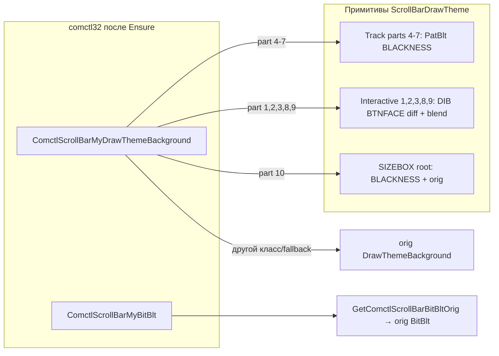

# Отрисовка скролл-бара в GlassProject

Документ описывает актуальную схему отрисовки `ScrollBar` после отказа от централизованного `ProcessDrawThemeBackground`.

---

## 1. Где теперь находится политика

`ScrollBarDrawTheme` больше не «роутер» по part/state.  
Он содержит только общие примитивы:

- `IsScrollBarTrackBackgroundPart()`
- `IsScrollBarInteractivePart()`
- `TryGetScrollBarDrawRect()`
- `TryDrawScrollBarInteractiveGlass()`
- `DrawScrollBarSizeBoxBlackThenOrig()`
- `LogScrollBarDrawThemeCall()`

Политика «что делать для конкретного `part/state`» теперь в хуках конкретных контролов:

- `ScrollBarThemeHooks.cpp` (`ComctlScrollBarMyDrawThemeBackground`)
- `ListViewHooks.cpp`
- `TreeViewHooks.cpp`
- `ListBoxHooks.cpp`
- `ComboLBoxHooks.cpp`
- `ComboBoxControlHooks.cpp`
- `DropDownHooks.cpp`

---

## 2. Текущие правила по частям

### 2.1. Дорожки (`part` 4..7)
- Всегда `PatBlt(..., BLACKNESS)` в клипе.

### 2.2. Интерактив (`part` 1,2,3,8,9)
- `TryDrawScrollBarInteractiveGlass()`:
  - два 32bpp DIB;
  - baseline = `COLOR_BTNFACE`;
  - rendered = `COLOR_BTNFACE` + `orig(DrawThemeBackground)`;
  - `ApplyDiffMask32` + `GdiAlphaBlend`.

### 2.3. Угол (`SBP_SIZEBOX`, `part` 10)
- **Root/comctl32 путь (`ScrollBarThemeHooks`)**: `BLACKNESS` + `orig` поверх (`DrawScrollBarSizeBoxBlackThenOrig`).
- **Вложенные контролы (`ListView/TreeView/...`)**: `BLACKNESS` (без `orig`) в их DTB-ветках `ScrollBar`.

Отдельно: в `ListView` и `TreeView` угол может приходить не через DTB(`part=10`), а через `FillRect(COLOR_BTNFACE)` в COMCTL32. Для этого есть отдельный `FillRect`-кейс по квадрату размера полосы прокрутки.

---

## 3. Маска фона (текущий тест)

В `ScrollBarDrawTheme.cpp` в `ApplyDiffMask32` добавлен тестовый допуск к фону:

- `kBgColorTolerance = 8`
- `effectiveDelta = max(delta - kBgColorTolerance, 0)`
- alpha строится от `effectiveDelta`, а не от сырого `delta`.

Это снижает чувствительность маски к небольшим отклонениям от `COLOR_BTNFACE`.

---

## 4. FillRect-путь для угла в ListView/TreeView

Для `ListView` и `TreeView` добавлена специальная обработка `FillRect`:

- проверка `LOGBRUSH` (`BS_SOLID`);
- цвет кисти близок к `COLOR_BTNFACE` (строгий `COLOR_BTNFACE` в текущей версии);
- прямоугольник квадратный;
- сторона равна ширине полосы прокрутки (с допуском `±1`).

Размер полосы берется через DPI-aware кэш:

- `GetSystemMetricsForDpi(SM_CXVSCROLL / SM_CYHSCROLL)` при `dpi != 96`;
- fallback на `GetSystemMetrics` при необходимости;
- thread-local кэш `dpi -> bandSize`.

Хук `FillRect` включается для обоих comctl:

- `g_comctl32New`
- `g_comctl32Legacy`

---

## 5. Установка IAT на comctl32

Установка **не** при загрузке процесса, а **лениво** при первом подходящем вызове. **Два триггера** (один и тот же `EnsureComctlScrollBarIatIfComctlCaller`):

| Триггер | Где в коде | Типичный `HWND` | Типичный caller (`DetourGetContainingModule`) |
|--------|------------|-----------------|--------------------------------------------------|
| **`HookBeginPaint` → `onBegin`** | `TreeViewHooks` / `ListViewHooks` / `ComboLBoxHooks` (`OnPaintBeginGlobal`, у ComboLBox также hot/scroll + PrintClient) | **SysTreeView32** / **SysListView32** / **ComboLBox** | **comctl32** (возврат из цепочки `BeginPaint` / аналог) |
| **`HookGetDCEx`** | `PaintDispatcher::HookGetDCEx` | окно из `GetDCEx` (иногда родитель, напр. **CabinetWClass**) | **comctl32** или **uxtheme** |

**Важно:** `onBegin` у paint-провайдеров вызывается **до** оригинального `BeginPaint` (`PaintDispatcher.cpp`), поэтому IAT на comctl32 для дерева/списка может установиться **до** первой отрисовки после входа в `WM_PAINT`. **`GetDCEx`** подстраховывает цепочку темизации, когда возврат лежит в **uxtheme** и/или `HWND` в вызове не совпадает с **SysTreeView32**.

Общие условия **`Ensure`** (выполняются для обоих триггеров):

1. **Caller:** базовое имя образа **`comctl32.dll`** или **`uxtheme.dll`** (и согласованные варианты — см. `ScrollBarThemeHooks.cpp`).
2. **HWND:** `ScrollBarTheme::ShouldInstallScrollBarIatForHwnd(hWnd)` — **`GlassIsComctlScrollHost(hwnd)`** (второй prop, см. ниже) **или** whitelist **`GlassGetWindowKind`** (ListView, TreeView, ComboLBox, DirectUI, NetUI, WinForms и др. — см. `ScrollBarThemeHooks.cpp`).

Дополнительно **`GlassShared::GlassMarkComctlScrollHost`** выставляется в **`Root_Attach`** только при **`InjectionMode::Full`**, после успешного `SetWindowSubclass`, с отсевом классов (**`ComboBoxEx32`**, **`Shell_TrayWnd`**, **`Shell_SecondaryTrayWnd`**, список расширяемый в `RootSubclass.cpp`). Снятие: **`GlassClearComctlScrollHost`** рядом с **`GlassUnmarkWindow`** (detach / `WM_GLASS_DETACH_ROOT` / `WM_NCDESTROY`).

При **выгрузке** экземпляра comctl32 **`ModuleHandler`** вызывает **`ScrollBarTheme::OnComctl32ModuleUnload`**. При shutdown ядра — **`ScrollBarTheme::ShutdownComctlScrollBarIat`** (в т.ч. из **`ScrollBar::Shutdown`**).

**BitBlt:** `ComctlScrollBarMyBitBlt` разрешает **`orig`** через **`ScrollBarTheme::GetComctlScrollBarBitBltOrig`** (обход стека + карта `g_comctlScrollBarMap`).

---

## 6. `DrawThemeOrigCallDepth` и ListView

Внутри **`TryDrawScrollBarInteractiveGlass`** (и при `ForwardToOrigWithDepth`) вызов настоящей темы **`orig`** на memory-DC оборачивается в **`ScrollBarTheme::DrawThemeOrigCallDepth`**.

Это увеличивает **thread-local** счётчик **`IsInsideScrollBarDrawThemeOrig()`**.

**Зачем:** в **`ListViewHooks`** перехват **`BitBlt` / `StretchBlt`** для иконок использует альфа-композитинг. Вызовы **`BitBlt` из цепочки uxtheme/comctl32 во время «настоящего» `DrawThemeBackground(ScrollBar)`** не должны обрабатываться как перенос иконки. Поэтому в этих хуках есть ранний выход:

- если **`ScrollBarTheme::IsInsideScrollBarDrawThemeOrig()`**, вызывается **`orig`** без LV-логики.

---

## 7. Поток данных (упрощённо)

Триггеры установки IAT — см. раздел 4: **`HookBeginPaint` → onBegin** (TreeView/ListView) и **`HookGetDCEx`**. В обоих случаях `EnsureComctlScrollBarIatIfComctlCaller` требует **гейт по `hWnd`** (`ShouldInstallScrollBarIatForHwnd`) и caller **`comctl32`** или **`uxtheme`** / согласованные образы (см. `ScrollBarThemeHooks.cpp`). IAT вешается на **модуль(и) comctl32** (`caller` comctl32 → тот же `HMODULE`; caller uxtheme → **`RunInActCtx` + v6 + legacy**). Для **TreeView** при отсутствии записи в карте IAT остаётся **fallback** в `Overall_MyDrawThemeBg` по теме `ScrollBar`.

---

## 8. Итог

**Перехват `DrawThemeBackground` на comctl32 остаётся основной точкой обработки `ScrollBar`**, но политика теперь распределена по конкретным `*Hooks.cpp` контролов, а `ScrollBarDrawTheme.cpp` предоставляет только общие building blocks.

---

## 9. Быстрый указатель файлов

| Компонент | Путь |
|-----------|------|
| Примитивы ScrollBar (diff-маска, rect utils, sizebox helper) | `GlassCore/src/Hooks/ScrollBarDrawTheme.cpp` |
| Карта comctl32 IAT, Ensure, shutdown, BitBlt orig | `GlassCore/src/Hooks/ScrollBarThemeHooks.cpp` |
| Публичный API примитивов | `GlassCore/include/Hooks/ScrollBarDrawTheme.h` |
| Публичный API depth/orig | `GlassCore/include/Hooks/ScrollBarTheme.h` |
| Ленивая установка IAT | `PaintDispatcher.cpp` (`HookGetDCEx`); плюс `onBegin` в `TreeViewHooks.cpp` / `ListViewHooks.cpp` |
| Выгрузка comctl32 | `GlassCore/src/Module/ModuleHandler.cpp` |
| Маркер ComctlScrollHost | `GlassShared/include/GlassComctlScrollHost.h`, `WndCompat/Root/RootSubclass.cpp` |
| DUI DTB (без ScrollBar comctl32) | `GlassCore/src/Hooks/DirectUIHooks.cpp` |

---

**Примечание:** `kBgColorTolerance` в diff-маске — тестовый параметр и может быть изменён/откачен после проверки.
