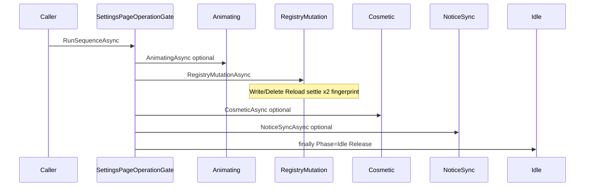

# GlassSettings — page operation pipeline (serial-конвейер)

**Для ассистентов:** любая **атомарная** пользовательская операция на detail-странице, которая одновременно трогает **анимацию**, **запись реестра**, **cosmetic UI** (превью, индикаторы) и **notice**, должна идти через этот конвейер — **не** в обход и **не** с переставленными фазами.

Связанные документы: [GlassSettings-notices.md](GlassSettings-notices.md) (notice/defer), [DwmColorizationPage.md](DwmColorizationPage.md) (эталон — «Композиция»), [GlassSettings-slider-commit.md](GlassSettings-slider-commit.md) (live-слайдеры **вне** pipeline).

Код: [`SettingsPageOperationGate`](../../GlassSettings/Services/SettingsPageOperationGate.cs), [`SettingsPageOperationSequence`](../../GlassSettings/Services/SettingsPageOperationGate.cs), host — [`SettingsPageShell.Operations`](../../GlassSettings/Controls/SettingsPageShell.xaml.cs).

---

## Назначение

| Проблема без конвейера | Как решает pipeline |
|------------------------|---------------------|
| Notice мигает на каждый `MarkDirty` внутри транзакции | Один `FlushSessionNotice` в **NoticeSync** |
| RegWatch / external-sync пересекается с нашей записью | Defer evaluate/commit на фазах gate |
| Превью и pivot-анимация прерывают друг друга | Serial-очередь + явные фазы + defer preview timer |
| Параллельные pivot/toggle ломают UI | `SemaphoreSlim(1)` — второй `RunSequenceAsync` **ждёт** |

---

## Порядок фаз (обязательный)



| # | Фаза | Разрешено | Запрещено |
|---|------|-----------|-----------|
| 0 | **Idle** | live preview timer, notice, reg watch | — |
| 1 | **Animating** | pivot transition, collapse expander, **параллельные** UI-анимации (`Task.WhenAll`) | `WriteDwm*` / `DeleteDwm*`, `FlushSessionNotice` |
| 2 | **RegistryMutation** | `WriteDwm*` / `DeleteDwm*`, `Reload*`, `_loading`, `MarkDirty` | cosmetic preview crossfade как финальный flush notice |
| 3 | **Cosmetic** | read-only refresh: превью states, indicators, chrome | повторная запись реестра; `FlushSessionNotice` |
| 4 | **NoticeSync** | **один** `FlushSessionNotice` / `RefreshProgrammatic` | — |
| 5 | **Idle** | (авто в `finally`) | — |

**Пропуск фаз:** допустим (например bool-toggle без Animating). **Перестановка фаз** — нет.

---

## API

```csharp
await PageShell.Operations.RunSequenceAsync(async seq =>
{
    // опционально: гасить конкурирующие legacy-timer до фаз
    CancelExternalPreviewRefresh();

    await seq.AnimatingAsync(async () => { /* UI animation */ });

    await seq.RegistryMutationAsync(async () =>
    {
        SettingsSession.Current.WriteDwmDword(...);
        _loading = true;
        try { ReloadSomething(); }
        finally { _loading = false; }
    });

    await seq.CosmeticAsync(() => { /* preview, indicators */ });
    // или await seq.CosmeticAsync(async () => { await LongRunningCosmetic(); });

    await seq.NoticeSyncAsync(() => PageShell.FlushSessionNotice());
});
```

| Метод | Async удержание очереди |
|-------|-------------------------|
| `AnimatingAsync(Func<Task>)` | до завершения `work` |
| `RegistryMutationAsync` | + 2× `RunAfterUiSettledAsync` + `SyncFingerprintFromSnapshot` |
| `CosmeticAsync(Action)` | sync, сразу дальше |
| `CosmeticAsync(Func<Task>)` | до завершения Task (crossfade и т.п.) |
| `NoticeSyncAsync` | sync |

`SettingsPageOperationGate.Current` — статический контекст активной транзакции (только внутри `RunSequenceAsync`).

---

## Флаги defer (проверять в обработчиках страницы)

| Свойство | true на фазах | Типичное использование на странице |
|----------|---------------|-------------------------------------|
| `ShouldDeferNotices` | Animating, RegistryMutation, Cosmetic | не открывать/мигать notice; копить dirty в session |
| `ShouldDeferRegistryWatch` | Animating … NoticeSync | RegWatch evaluate/commit отложен |
| `ShouldBlockPageMutation` | Animating, RegistryMutation | `_deferredPreviewRefresh = true` вместо preview timer |
| `IsBusy` | любая фаза ≠ Idle | guard re-entrancy |

---

## Deferred preview (паттерн «Композиция»)

`Session_OnDirtyChanged` во время defer:

```csharp
if (SettingsPageOperationGate.Current?.ShouldDeferNotices == true
    || SettingsPageOperationGate.Current?.ShouldBlockPageMutation == true)
    _deferredPreviewRefresh = true;
else
    ScheduleExternalPreviewRefresh(); // 450 ms debounce, Idle-only path
```

**Cosmetic** после RegistryMutation: `FlushDeferredExternalPreviewRefresh()` — **только states** (`RefreshCompositionPreviewStatesFromRegistry`), без повторного mode/crossfade.

На **входе** в `RunSequenceAsync`: `CancelExternalPreviewRefresh()` — гасит timer из прошлого Idle.

Crossfade guard: `SetCompositionVisibleMode(animate: false)` и timer **не** прерывают активный `UiElementCrossfade` (`IsAnimating`).

---

## Эталон: GlassType pivot ([`DwmColorizationDetailPage`](../../GlassSettings/Pages/Dwm/DwmColorizationDetailPage.xaml.cs))

Единственная страница с полным набором фаз + параллельная Animating.

| Фаза | Действия |
|------|----------|
| вход | `CancelExternalPreviewRefresh()` |
| **Animating** | collapse expanders; `Task.WhenAll(PivotTabContentTransition, PrepareCompositionPreviewPivotAsync)` — **states из реестра до crossfade**, не UI gate |
| **RegistryMutation** | `CommitGlassTypeFromPivot`, `Reload*` |
| **Cosmetic** | indicators, `FlushDeferredExternalPreviewRefresh()` |
| **NoticeSync** | `FlushSessionNotice()` — mirror sync через `EvaluatePinnedMirrorPolicy` (без отдельного dedup) |

**NoticeSync** (кнопка «Сохранить», вне `RunSequenceAsync`): [`SaveAsync`](../../GlassSettings/Controls/SettingsSessionNoticeBar.xaml.cs) — retract yellow → commit → `RunAfterUiSettledAsync` ×2 → `InformationalLayoutSettleMs` (400 ms) → green informational mirror. Пока активен informational epoch, `DirtyChanged(!dirty)` **не** вызывает `CloseNoticeImmediate`; pinned `SyncMirror` не деактивирует shared host.

**GlassType pivot + unsaved после Save:** pivot `MarkDirty` → `FlushSessionNotice` → Yellow. Coordinator **обязан** retract stale Green MirrorOnly entry **до** `ProjectHostAsync`, иначе flash green→yellow (re-present Green, затем Yellow).

Programmatic sync (`SyncGlassTypePivotFromRegistry` в `Reload()`): `_lastGlassTypePivotIndex` обновляется **до** `SelectedIndex`; `GlassTypePivot_OnSelectionChanged` выходит при `_loading` — `CommitGlassTypeFromPivot` только при явном переключении пользователем.

Vista inactive split в превью: ключ `ColorizationColorInactive` exists → два tint-rect; gate спойлера для split **не** используется (см. [DwmColorizationPage.md](DwmColorizationPage.md)).

Длительность crossfade превью = `PivotTabContentTransition.TabChangeTotalDuration` (500 ms).

---

## Другие транзакции на «Композиции» (без Animating)

| Операция | RegistryMutation | Cosmetic | NoticeSync |
|----------|------------------|----------|------------|
| Composition bool toggle | Write/Delete + Reload | preview, chrome | always |
| Master OFF | Delete keys + Reload | preview, chrome | always |

---

## Что **не** через pipeline

| Сценарий | Почему |
|----------|--------|
| Live slider / color picker debounce | `SettingsSliderCommit`, `Task.Run` live-write; `MarkDirty` на commit жеста |
| BaseColor / BaseOpacity pivot | только UI transition + reload, без registry transaction batch |
| External reg watch → preview timer | Idle path, 450 ms debounce |
| Navigate away / Reload() страницы | вне пользовательской транзакции |

Новая detail-операция с **записью реестра + заметным UI + notice** → добавить `RunSequenceAsync` по шаблону выше.

---

## Anti-patterns

| Нельзя | Почему |
|--------|--------|
| `FlushSessionNotice` в RegistryMutation или Cosmetic | notice до стабилизации UI; мигание |
| `RefreshCompositionPreviewFromRegistry` (mode) во время crossfade | прерывает Storyboard → «пропадание» превью |
| `BuildVistaPreviewState` с gate для split при pivot | gate ещё от Win7; скачок после Reload |
| `ApplyState` на обоих слоях crossfade mid-flight + FlushDeferred | ломает blur pipeline |
| Второй `RunSequenceAsync` «поверх» без await первого | serial queue ждёт — OK; обход gate через прямой Write — **не OK** |
| Mix registry write в Cosmetic | нарушает контракт фаз |
| Yellow upsert на session strip без retract Green MirrorOnly | stale Green entry → `ProjectHostAsync` re-present success перед warning (flash при GlassType pivot) |

---

## Расширение на новые страницы

1. Обернуть handler в `PageShell.Operations.RunSequenceAsync`.
2. Разнести: animation → registry → cosmetic read-only → notice once.
3. В `DirtyChanged`/watch проверять `SettingsPageOperationGate.Current?.ShouldDefer*`.
4. Документировать транзакцию в page-guide (как [DwmColorizationPage.md](DwmColorizationPage.md)).
5. Добавить строку в таблицу «Adopters» ниже.

### Adopters (код)

| Страница | Файл | Транзакции |
|----------|------|------------|
| DWM «Композиция» | `DwmColorizationDetailPage.xaml.cs` | GlassType pivot, composition toggles, master OFF |
| DWM «Внешний вид» | `DwmGlassDetailPage.xaml.cs` | Gate секций General / Window / Caption |
| DWM hub «Система» | `DwmSettingsHubPage.xaml.cs` | Gate «Общие установки», battery/safety checkboxes, DisabledHooks toggles, hooks «По умолчанию» (RegistryMutation + NoticeSync, без Cosmetic); `IExternalRegistrySyncReloadable`, scope `DwmSystemScopeCatalog.AllScope(Hklm)` / `DwmPlatform` для RegWatch |
| «Текст и шрифты» | `TextAndFontsPage.xaml.cs` | Pivot системных шрифтов, gate OFF, font pick (RegistryMutation + NoticeSync); pivot change (Animating); SPI apply on Save via `SystemFontsApplyService`; `WindowMetricsRegistryWatchService` |

*На момент документа — потребители `RunSequenceAsync`.*

---

## Перекрёстные эффекты

- **External-sync settle** отменяется на фазах pipeline ([GlassSettings-notices.md](GlassSettings-notices.md)).
- **RegistryMutation** всегда sync fingerprint после settle — логи `SyncFingerprintFromSnapshot: cancel settle` в pivot штатны.
- После `finally` (Idle): `TryScheduleDeferredRegistryEvaluate()` если watch был отложен.
