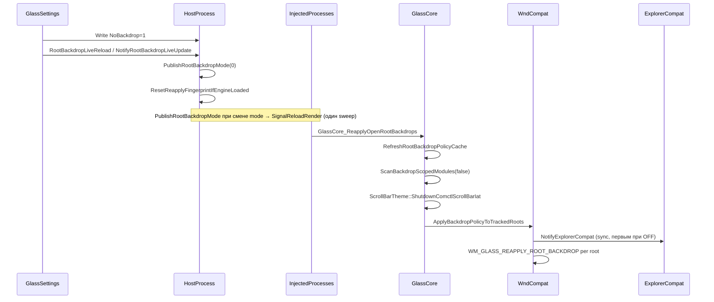
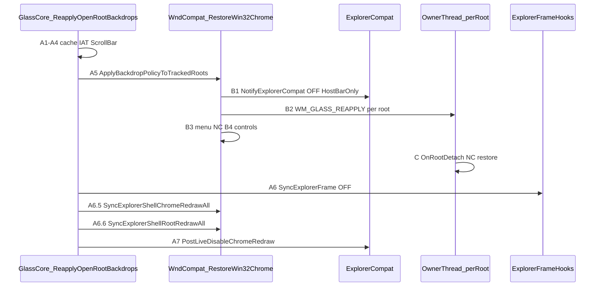
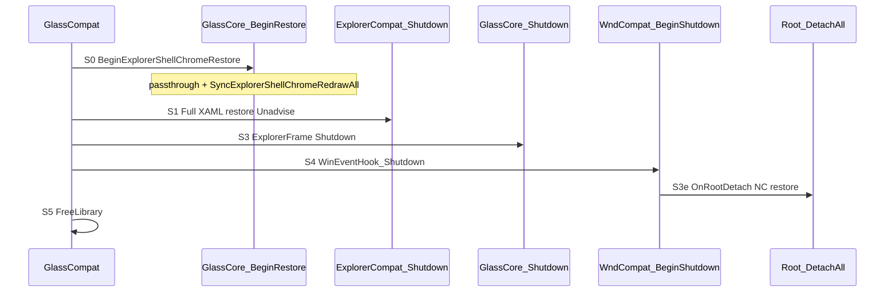

# Live-отключение «сплошного стекла» (NoBackdrop=1 / NONE)

Каноническая последовательность процедур при выключении backdrop для root-окон.
Цель документа — не допускать регрессий: новый хук или live-reload должен
вписываться в эту цепочку или явно документировать исключение.

См. также: [GlassSettings-host-glass.md](GlassSettings-host-glass.md),
[GlassSettings-WinUI.md](GlassSettings-WinUI.md),
[ExplorerXamlIslands.md](ExplorerXamlIslands.md).

---

## Семантика

| Реестр / UI | `RootBackdropMode` | Смысл |
|-------------|-------------------|--------|
| `Root\NoBackdrop=0`, toggle «Сплошное стекло» **ON** | 1 (DWM) или 2 (SWCA) | backdrop и glass-paint разрешены |
| `Root\NoBackdrop=1`, toggle **OFF** | 0 | backdrop подавлен (**мягкий NONE**) |
| Старый `BackDropType=0` в реестре | 0 | тот же runtime-sweep, что и `NoBackdrop=1` |

**Мягкий NONE:** subclass, IAT и in-memory реестры HWND **не снимаются**
(`Root_DetachAll` — только при shutdown платформы). Меняются backdrop, paint-gate,
hooks-cache и визуальное состояние контролов.

---

## Общая схема (live OFF)

---

## Шаг 1 — UI и запись в реестр

### GlassSettings (основной путь)

1. Пользователь переключает **«Сплошное стекло»** OFF
   (`RootFullGlassRow` / «Разрешить backdrop» на `RootWindowsPage`).
2. `WriteBwmDword("Root", "NoBackdrop", 1)` — не при `_loading` / sync из `Loaded`.
3. [`RootBackdropLiveReload.NotifyNoBackdropChange(1)`](../../GlassSettings/Core/Platform/RootBackdropLiveReload.cs).

---

## Шаг 2 — Live reload (хост + injected)

Источник: [`RootBackdropLiveReload.cs`](../../GlassSettings/Core/Platform/RootBackdropLiveReload.cs).

| # | Действие | Зачем |
|---|----------|-------|
| 1 | `NativeHostInterop.NotifyRootNoBackdropChanged(1)` | snapshot `RootBackdropMode=0`; при смене mode → `SignalReloadRender` в injected GUI |
| 2 | `ResetReapplyFingerprintIfEngineLoaded()` | sweep не пропускается (`ShouldSkipReapplySweep`) |

> **Anti-pattern:** `NotifyDwmColorizationChanged` в `RootBackdropLiveReload` поверх
> `PublishRootBackdropMode` — второй sweep (~2.5 с) и мерцание шапки проводника.
> **Anti-pattern:** дублирующий `SignalReloadRender` в `RootBackdropLiveReload` поверх
> `PublishRootBackdropMode` — двойной reload.
> **Anti-pattern:** только `NotifyDwmColorizationChanged` без reload через `PublishRootBackdropMode` —
> injected-процессы не получают `GlassCore_ReapplyOpenRootBackdrops`.

---

## Шаг 3 — `GlassCore_ReapplyOpenRootBackdrops` (каждый процесс с движком)

Источник: [`RootEvents.cpp::ReapplyOpenRootBackdrops`](../../GlassCore/src/Subsystems/RootEvents.cpp).

| # | Вызов (OFF, `RootBackdropMode=0`) |
|---|--------|
| 1 | `RefreshRootBackdropPolicyCache()` |
| 2 | `SyncOpenGlassParameters()` |
| 3 | `ScanBackdropScopedModules(false)` — снятие backdrop-scoped IAT |
| 4 | `ScrollBarTheme::ShutdownComctlScrollBarIat()` — comctl32 **не** в backdrop-scoped |
| 5 | `WndCompat_ApplyBackdropPolicyToTrackedRoots()` (или зарегистрированный applier) |
| 6 | `ExplorerFrameControl::SyncExplorerFrameBackdropHookFromRegistry()` — **после** sweep (`g_bgHooksEnabled=false`, `RestoreExplorerFrameChrome(LiveOff)`) |
| 7 | `ExplorerCompat_PostLiveDisableChromeRedraw` — GDI undo + CHROME + SizeToggle на XAML-потоке (**только live OFF**) |

При **ON** шаг 6 (`SyncExplorerFrame`) выполняется **до** applier (как раньше).

Экспорт: `GlassCore_ReapplyOpenRootBackdrops`.

---

## Шаг 4 — Per-root sweep (WndCompat)

Для каждого HWND из `g_rootWindows` — [`MarshalApplyRootBackdropReapplyForHwnd`](../../WndCompat/Root/RootSubclass.cpp)
→ `WM_GLASS_REAPPLY_ROOT_BACKDROP` на поток владельца (или прямой вызов).

[`ApplyRootBackdropReapplyOnOwnerThreadImpl`](../../WndCompat/Root/RootSubclass.cpp) при `!IsRootGlassRenderingEnabled()`:

**Для `CabinetWClass`/`ExploreWClass` (Win11):** [`RestoreRootWin32Chrome`](../../WndCompat/Root/Win32ChromeRestore.cpp) — сокращённый путь: `GlassMarkRootBackdropAllowed(false)` + `GlassCore_ApplyRootBackdropPolicyTransitionForHwnd` → `OnRootDetach` → **`RestoreWin11ExplorerStockFrame`** + **`RedrawExplorerShellRootFull`**. **Не вызываются:** `RestoreRootClassBrush`, `RestoreRootNcAfterDetach`, `OnRootHooksDetach`.

| # | Действие | Win11 Cabinet/Explore | Прочие root |
|---|----------|----------------------|-------------|
| 1 | `GlassMarkRootBackdropAllowed(hRoot, false)` | да | да |
| 2 | `OnRootDetach` → `RestoreWin11ExplorerStockFrame` (единая функция) | да | blur/extend off |
| 3 | `DropEffect` + blur off + `DwmExtendFrame {0,0,capH,0}` + **`DWMSBT_MAINWINDOW` (ET=7)** | да | n/a |
| 4 | caption/text DEFAULT + `ApplyBorderEffect` (attr 33/34) | да | n/a |
| 5 | `DwmTransitionOwnedWindow` + NC render | да | n/a |
| 6 | `TriggerWindowNCRendering` + bookkeeping | да | да |
| 7 | `MenuOwner_ReleaseClassicMenuBarHold` + class brush + `OnRootHooksDetach` | **нет** | да |
| 8 | `RestoreRootNcAfterDetach` (RDW_ERASE + WM_NCACTIVATE nudge) | **skip** (early return) | если `DidGlassApplyRootBackdrop` |
| 9 | `RedrawExplorerShellRootFull` (`RDW_ERASE\|ALLCHILDREN\|FRAME` на root) | да | n/a (см. строку 8) |

**`capH` (высота шапки):** 1) IAT-capture `GlassPlatform.ExplorerStockTopMargin` (native `cyTopHeight` до force `-1`); 2) верхний `DesktopChildSiteBridge` / `XamlExplorerHostIslandWindow`; 3) `SM_CYCAPTION+SM_CYSIZEFRAME+SM_CXPADDEDBORDER`.

**Explorerframe IAT при OFF/STOP:** `ShouldPassthroughExplorerFrameHooks` → `orig` в `DwmExtendFrameIntoClientArea` и `DwmSetWindowAttribute` (attr 38/35 без Glass path1/2), пока IAT физически стоит.

Лог: `[GlassCore][Root] Win11 explorer stock restore: ... stockTopMargin=H sbt=2`

**OnRootDetach Win11:** `DidGlassApplyRootBackdrop` **или** `DidExplorerIATExtendApply`.

**CHROME (A6.5/S0):** `TriggerExplorerShellChromeRedrawAll` → `TryHandleChromeRedraw` **repaint-only** (без NCACTIVATE/SWP_FRAMECHANGED).

**Full redraw (A6.6/S0):** `TriggerExplorerShellRootRedrawAll` → `WM_GLASS_EXPLORER_ROOT_FULL_REDRAW` → `RedrawExplorerShellRootFull` — **единый** `RedrawWindow` на root+children (scrollbars/dividers). **Не** полагаться на per-control `ScrollBar_ApplyBackdropPolicyToTracked` для восстановления comctl-полос.

**Не вызывается:** `RemoveWindowSubclass`, `Root_DetachAll`.

---

## Шаг 5 — Per-control sweep

**Entry (live OFF):** [`RestoreWin32Chrome(LiveNoBackdrop)`](../../WndCompat/Root/Win32ChromeRestore.cpp) —
notify ExplorerCompat → per-root [`RestoreRootWin32Chrome`](../../WndCompat/Root/Win32ChromeRestore.cpp) → menu NC → [`RestoreTrackedControlsWin32Chrome`](../../WndCompat/Root/Win32ChromeRestore.cpp).

**Entry (shutdown):** `WinEventHook_Shutdown` → `TaskbarHost_DetachAll` → `RestoreTrackedControlsWin32Chrome(ShutdownDetach)` (тот же порядок `*_DetachAll`, что раньше).

Источник диспетчера контролов: [`Win32ChromeRestore.cpp`](../../WndCompat/Root/Win32ChromeRestore.cpp); live ON по-прежнему через [`ApplyBackdropPolicyToTrackedRootsImpl`](../../WndCompat/Root/RootSubclass.cpp).

| Модуль | Функция | При OFF |
|--------|---------|---------|
| Button | `Button_ApplyBackdropPolicyToTracked` | unregister ThemePaint |
| TreeView | `TreeView_ApplyBackdropPolicyToTracked` | restore visuals + redraw |
| ListView | `ListView_ApplyBackdropPolicyToTracked` | restore bk colors + redraw |
| DirectUI | `DirectUI_ApplyBackdropPolicyToTracked` | policy transition |
| Rebar | `Rebar_ApplyBackdropPolicyToTracked` | restore + redraw |
| ToolBar | `ToolBar_ApplyBackdropPolicyToTracked` | restore + redraw |
| ScrollBar | `ScrollBar_ApplyBackdropPolicyToTracked` | `RedrawWindow` |
| Explorer island | `ExplorerIslandContainer_ApplyBackdropPolicyToTracked` | `RestoreIslandDefaultAfterDetach` |
| Explorer XAML | `GlassCompat_NotifyExplorerRootBackdropPolicyChanged(FALSE)` → `ExplorerCompat_OnRootBackdropPolicyChanged` | см. § Explorer |

При sweep **OFF:** [`RestoreWin32Chrome(LiveNoBackdrop)`](../../WndCompat/Root/Win32ChromeRestore.cpp) —
**сначала** `NotifyExplorerRootBackdropPolicyChanged(false)` (XAML restore свойств шапки, **без** GDI redraw),
**затем** per-root marshal + menu + controls.
При sweep **ON:** в начале — [`BackdropPolicyRescan::RescanAllMissingGlassHostsForBackdropEnable`](../../WndCompat/Tracker/BackdropPolicyRescan.cpp) (rescan missing roots + рекурсивный catch-up controls/WinUi hosts; **coalesce ~800 ms** на повторные вызовы); затем per-root sweep; notify `true` в конце.

**Initial scan (старт платформы):** [`BackdropPolicyRescan::RunProcessWindowScan`](../../WndCompat/Tracker/BackdropPolicyRescan.cpp) — рекурсивный обход `GW_CHILD`/`GW_HWNDNEXT` (не flat `EnumChildWindows`); cross-thread controls — `WM_GLASS_SYNTHETIC_CREATE`. После `Root_Attach` / `ExplorerRoot::Attach` — `ScheduleSubtreeRescanAfterRootAttach`. **Win11 explorer при glass ON:** `ExplorerRoot::Attach` после rescan вызывает `RedrawExplorerShellRootFull` (паритет `Root_Attach:1180-1181` для DWM/SWCA).

**Register-only attach:** `TreeView_Attach` / `ListView_Attach` / `Button_Attach` всегда помечают HWND и добавляют в tracker; визуалы / ThemePaint — только при `GlassIsBackdropAllowedForHwnd`.

Маршрут: [`GlassCompat_NotifyExplorerRootBackdropPolicyChanged`](../../GlassCompat/src/GlassCompat.cpp)
(`g_hExplorer`), fallback `GetModuleHandleW(ExplorerCompat.dll)`. **Обязательно:** export
`ExplorerCompat_OnRootBackdropPolicyChanged` в [`ExplorerCompat.def`](../../ExplorerCompat/ExplorerCompat.def)
— без него `GetProcAddress` возвращает `nullptr` и restore шапки молча не выполняется.
**Не дублировать** notify из `GlassGuiThread` после `ReapplyOpenRootBackdrops` (belt удалён).
Anti-pattern: silent return без лога, если модуль не найден.

---

## Шаг 6 — Explorer Win11 XAML (только ЗОНА 3)

**Доставка live-sweep:** [`NotifyExplorerRootBackdropPolicyChanged`](../../WndCompat/Root/Win32ChromeRestore.cpp)
→ `GlassCompat_NotifyExplorerRootBackdropPolicyChanged` ( [`GlassCompat.cpp`](../../GlassCompat/src/GlassCompat.cpp), `g_hExplorer`)
→ `ExplorerCompat_OnRootBackdropPolicyChanged`
→ **`XamlShutdownMarshal::RunRootBackdropPolicyChangeOnXamlThread`**
→ `SendMessageTimeout` (`WM_GLASS_EXPLORER_ROOT_BACKDROP_POLICY`) на поток Advise (HWND_MESSAGE)
→ [`XamlTapSite::OnRootBackdropDisabled`](../../ExplorerCompat/xaml/XamlTapSite.cpp) → **`RestoreExplorerHostBarChrome`**.

**Потоковый контракт:** `RestoreHostBar` / `IVisualTreeService` / WinUI `SetProperty` — **только**
на XAML Advise-потоке. Прямой вызов `OnRootBackdropDisabled` с GlassGuiThread → ACCESS_VIOLATION
(0xC0000005) и restart explorer. Stop/shutdown использует тот же маршалинг (`WM_GLASS_EXPLORER_XAML_SHUTDOWN`).

Stop/shutdown по-прежнему: `GlassCompat` → `ExplorerCompat_Shutdown` → `RestoreAllFills` → [`RestoreExplorerChrome(Full)`](../../ExplorerCompat/xaml/Patcher/XamlHostBarPatcher.h).

**Две entry patch/unpatch (ЗОНА 3):** [`ApplyExplorerChrome`](../../ExplorerCompat/xaml/Patcher/XamlHostBarPatcher.h) / [`RestoreExplorerChrome`](../../ExplorerCompat/xaml/Patcher/XamlHostBarPatcher.h) — вся логика DP внутри; снаружи только `scope`.

| Событие | Patch/Restore | Post ([`XamlTapSite`](../../ExplorerCompat/xaml/XamlTapSite.cpp)) |
|---------|---------------|---------------------------------------------------------------------|
| VTC Add (Attach) | `ApplyExplorerChrome(Incremental, element, parent)` | — |
| Live ON | `ApplyExplorerChrome(FullReplay)` | [`AfterExplorerChromeApplied`](../../ExplorerCompat/xaml/XamlTapSite.cpp) |
| Live OFF | `RestoreExplorerChrome(HostBarOnly)` | [`AfterExplorerChromeRestored`](../../ExplorerCompat/xaml/XamlTapSite.cpp) |
| Shutdown / Detach_All | `RestoreExplorerChrome(Full)` + `ClearPatchedExplorerShellHwnds` | `PaintPumpBrief` **до** Unadvise → `RedrawAllAfterXamlShutdown` после Unadvise |

**Единая точка restore шапки (live OFF):** [`XamlTapSite::RestoreExplorerHostBarChrome`](../../ExplorerCompat/xaml/XamlTapSite.cpp) —
`RestoreExplorerChrome(HostBarOnly)` + [`AfterExplorerChromeRestored`](../../ExplorerCompat/xaml/XamlTapSite.cpp)
(GDI undo → Invalidate WinUI hosts → CHROME_REDRAW → SizeToggle). Повторный вызов в том же toggle (&lt;2 с) — skip redraw (re-entrancy guard).
Stop: `RestoreExplorerChrome(Full)` → **`PaintPumpBrief`** (пока Advise активен) → Unadvise → `RedrawAllAfterXamlShutdown`.

| Действие | Stop/shutdown | Live NoBackdrop OFF |
|----------|---------------|---------------------|
| `RestoreExplorerChrome(Full)` (popup + host bar + fills) | да | **нет** |
| `RestoreExplorerChrome(HostBarOnly)` (ЗОНА 3+4) | через Full | **да** |
| `UnadviseVisualTreeChange` | да | **нет** (TAP остаётся) |
| `g_disableHostBarPatching=true` | временно | **сразу** в ExplorerCompat + HostBarOnly |
| `g_disableHostBarPatching=false` (live ON) | — | **до** FullReplay: ExplorerCompat + `ApplyExplorerHostBarChrome`; FullReplay гейтит только `IsRootGlassRenderingEnabled`, не свой флаг |
| `IsExplorerXamlPatchingAllowed()` gate в VTC | — | **да** (ЗОНЫ 3/4, GDI-prime, menu-rect); после ON флаг сброшен — Incremental снова активен |
| GDI undo + SizeToggle + CHROME + Invalidate hosts | да (`AfterExplorerChromeRestored`) | **да** (тот же helper) |

**ЗОНА 2 (XAML popup, `XamlPopupPatcher`) при live OFF не трогаем** — разработка
заморожена, код будет удалён. Не вызывать popup restore из live-sweep.

**Симметричная точка apply (ON):** [`XamlTapSite::ApplyExplorerHostBarChrome`](../../ExplorerCompat/xaml/XamlTapSite.cpp) —
[`ApplyExplorerChrome(FullReplay)`](../../ExplorerCompat/xaml/Patcher/XamlHostBarPatcher.cpp) — **тот же** `ApplyExplorerChrome(Incremental)`, что VTC Add: BFS от `DesktopWindowXamlSource`, на узле `TrackParent` + Incremental (без отдельного pipeline). Finisher: `RepatchTabElements` + lazy timer → [`AfterExplorerChromeApplied`](../../ExplorerCompat/xaml/XamlTapSite.cpp).
`RestoreHostBarPropertyPatches`: vts **сначала**, затем swap registry + `ClearProperty`. При stale registry на ON: `RestoreHostBarPropertyPatches` **перед** FullReplay BFS (restore-before-replay). Лог: `patchRegistrySize=0` / `WARN stale … restore-before-replay`.

**Симметричная точка restore (OFF):** [`XamlTapSite::RestoreExplorerHostBarChrome`](../../ExplorerCompat/xaml/XamlTapSite.cpp) —
`RestoreExplorerChrome(HostBarOnly)` + `PaintPumpBrief` (**без** GDI redraw на этом шаге).

**Win32 GDI+CHROME после live OFF:** [`RestoreExplorerFrameChrome(LiveOff)`](../../GlassCore/src/Hooks/ExplorerFrameHooks.cpp) — soft NONE (`restoreClassBrush=false`); IAT `DwmExtendFrameIntoClientArea` passthrough native margins при OFF (`ShouldForceFullFrameMarginsForExplorerShellRoot` + `IsRootGlassRenderingEnabled()`); затем [`ExplorerCompat_PostLiveDisableChromeRedraw`](../../ExplorerCompat/ExplorerCompat.cpp) → [`RestoreExplorerWin32Surfaces(HostBarOnly)`](../../ExplorerCompat/xaml/XamlTapSite.cpp) (GDI undo → Invalidate WinUI → `CHROME_REDRAW` → SizeToggle).

**Shutdown Win32 surfaces:** [`RestoreExplorerWin32Surfaces(HostBarAndTray)`](../../ExplorerCompat/xaml/XamlTapSite.cpp) после Unadvise (то же + tray redraw).

### Anti-pattern (live toggle)

- Параллельные entry: `ApplyExplorerChromeFromCache`, `RestoreExplorerChromeLiveDisable`, `ExplorerChromeLifecycle`, `ApplyExplorerChromeFromElementCache`.
- Вызов `RedrawExplorerHostBarSurfacesAfterRestore` (Undo GDI) в конце live ON apply.
- Replay с фильтром `TypeOrNameHintsExplorerUi`, `PatchCachedElement` или pre-loop lazy/caption — не VTC Add.
- `ForceRepatch` / bypass `g_hostBarPropertyPatches` в FullReplay.
- RestoreHostBarPropertyPatches: swap registry **до** vts (очистка без `ClearProperty` → шапка не восстанавливается).

---

## Чеклист для новых хуков (anti-regression)

При добавлении paint/IAT/lazy-install для root или контролов под root:

1. **Гейт backdrop:** `GlassShared::GlassIsBackdropAllowedForHwnd(hWnd)` в теле хука
   и/или перед установкой IAT (`GlassBackdropMark.h`). Корень с уже выставленным
   prop `GlassPlatform.RootBackdropAllowed` (1 или 2) не перечитывает класс трея
   и exempt-список: решение — эта метка и `IsRootGlassRenderingEnabled`.
2. **PaintDispatcher:** провайдеры BeginPaint/GetDC/compatDC — только через
   `ShouldInvokeProvidersForHwnd` (`PaintDispatcher.cpp`).
3. **comctl32 ScrollBar:** не входит в `ScanBackdropScopedModules`; при OFF нужен
   явный `ShutdownComctlScrollBarIat` в `ReapplyOpenRootBackdrops`; гейт в
   `EnsureComctlScrollBarIatIfComctlCaller` и `ComctlScrollBarMyDrawThemeBackground`.
4. **Explorer host bar:** live OFF — **`RestoreExplorerHostBarChrome`** (паритет redraw с Stop);
   VTC Add при OFF: `TrackElementMetadata` без SetProperty; gate — `IsExplorerXamlPatchingAllowed()`.
5. **Root attach при live OFF:** `ShouldAttachGlassToHwnd` (регистрация root **и** контролов) **без** NoBackdrop;
   визуалы при OFF подавляются через `GlassMarkRootBackdropAllowed`, `GlassIsBackdropAllowedForHwnd`, `ScanBackdropScopedModules(false)`.
6. **Live reload:** изменение `NoBackdrop` в UI → `NotifyRootNoBackdropChanged` /
   `PublishRootBackdropMode` (один `SignalReloadRender` при смене mode). **Не** дублировать
   reload из `RootBackdropLiveReload`.
7. **Не полагаться на DetachAll** для live OFF — используйте sweep из этого документа.

---

## Исключения (backdrop OFF не распространяется)

| Сценарий | Причина |
|----------|---------|
| `ComboLBox` (popup списка комбобокса) | `GlassIsBackdropAllowedForHwnd` всегда `true` |
| `Shell_TrayWnd` / secondary tray | отдельная политика `Tray\` |
| Root из `IsHwndBackdropExempt` | exempt-классы в `RootBackdropPolicy` |
| XAML popup-острова (ЗОНА 2) | заморожены; live restore не делаем |
| LogViewer (локальный GlassCore/WndCompat) | `IsCurrentProcessLogViewerHost()` → `NoBackdrop=0`, фиксированный SWCA `RootBackdropMode`, `ReapplyOpenRootBackdrops` no-op; **не** следует за старт/стоп платформы |
| GlassSettings (локальный GlassCore) | `IsCurrentProcessGlassToolHost()` → `IsRootGlassRenderingEnabled()` всегда `true` для preview API |

**Tool-host gate:** перед platform-wide notify/rescan/sweep в injected-процессах убедиться, что вызов не дублируется для tool-host без `IsCurrentProcessGlassToolHost()` — иначе UI настроек/log viewer потеряет glass при глобальном OFF.

---

## Обратный sweep (ON, `NoBackdrop=0`)

1. `ScanBackdropScopedModules(true)`.
2. `ScrollBarTheme` — ленивая переустановка IAT при следующем paint/GetDCEx.
3. `RescanAllMissingGlassHostsForBackdropEnable` + per-root: `ApplyRootGlassVisualsOnBackdropEnabled` (для explorer — `ExplorerRoot::ApplyShellBackdropOnBackdropEnabled`).
4. Per-control: `ApplyBackdropPolicyToTracked*` (TreeView, ListView, Button, …).
5. `ExplorerCompat_OnRootBackdropPolicyChanged(TRUE)` — `ApplyExplorerChrome(FullReplay)` через `ApplyExplorerHostBarChrome`.

---

## Отличие от shutdown платформы

| | Live OFF | Stop / `Root_DetachAll` |
|---|----------|-------------------------|
| `BeginExplorerShellChromeRestore` (S0) | нет | **да**, до ExplorerCompat |
| Subclass / IAT | остаются | снимаются |
| TAP / XAML Diagnostics | активен | `Unadvise` + полный `RestoreAllFills` |
| `g_rootWindows` | сохраняется | очищается |
| Popup XAML restore | нет | да (до удаления модуля) |
| `PostLiveDisableChromeRedraw` | **да** (шаг 7) | **нет** |
| Win11 explorer `OnRootDetach` | `ApplyWin11ExplorerShellNcRestoreOnDetach` | тот же путь |
| `RestoreRootNcAfterDetachImpl` | skip (Win11 explorer) | skip (Win11 explorer) |

---

## Live OFF — полная timeline (Win11 explorer)

Триггер: `PublishRootBackdropMode(0)` → `GlassCore_ReapplyOpenRootBackdrops` в каждом injected-процессе.

| Фаза | # | Когда | Что |
|------|---|-------|-----|
| A | A1–A4 | До sweep | cache refresh, `ScanBackdropScopedModules(false)`, ScrollBar IAT off |
| B | B1 | **Первым** в sweep | `RestoreExplorerHostBarChrome(HostBarOnly)` — XAML props, без GDI |
| B | B2–B4 | | per-root marshal → menu → controls |
| C | C1–C5 | На потоке владельца | `RestoreWin11ExplorerStockFrame` (ET=7 + top-margin=capH) |
| A | A6 | **После** B | `SyncExplorerFrame`: passthrough native ExtendFrame |
| A | A6.5 | После A6 | `TriggerExplorerShellChromeRedrawAll` — sync CHROME repaint-only |
| A | A6.6 | После A6.5 | `TriggerExplorerShellRootRedrawAll` — **full** `RedrawWindow` root+children |
| A | A7 | После A6.6 | `PostLiveDisableChromeRedraw` — XAML finisher; margin restore **не** зависит только от A7 |

**Порядок B1 до C намеренный:** XAML restore шапки до DWM teardown root.

---

## STOP платформы — полная timeline

Триггер: `GlassCompat::ExecuteShutdown` в explorer.exe.

| Фаза | # | Когда | Что (Win11 explorer) |
|------|---|-------|----------------------|
| S0 | S0 | **До S1** | `BeginExplorerShellChromeRestore`: passthrough + **`RestoreWin11ExplorerStockFrame` по tracked roots** + `TriggerExplorerShellChromeRedrawAll` + **`TriggerExplorerShellRootRedrawAll`** |
| S1 | S1 | **До Core** | `ExplorerCompat_Shutdown`: Full XAML + Win32 surfaces (passthrough DWM/ExtendFrame) |
| S2 | S2a | `GlassCore_Shutdown` | `ExplorerFrameControl::Shutdown` — hooks off, `RestoreExplorerFrameChrome(Shutdown)` |
| S3 | S3a–S3d | `WinEventHook_Shutdown` | Taskbar + controls `*_DetachAll` + `RemoveWindowSubclass` |
| S3 | S3e | per root | `OnRootDetach` → `ApplyWin11ExplorerShellNcRestoreOnDetach` (тот же C1–C5) |
| S3 | S3f | per root | `RestoreRootNcAfterDetachImpl` — **skip** |
| S3 | S3g | | `SetRootEventProvider({})` |
| S1 | S5 | | `FreeLibrary` Core → ExplorerCompat → WndCompat |

**Отличие от live OFF:** subclass снимается; XAML Full restore в S1; нет A6/A7 (`PostLiveDisableChromeRedraw` не вызывается); margin restore на STOP — в **S0** (sync CHROME).
