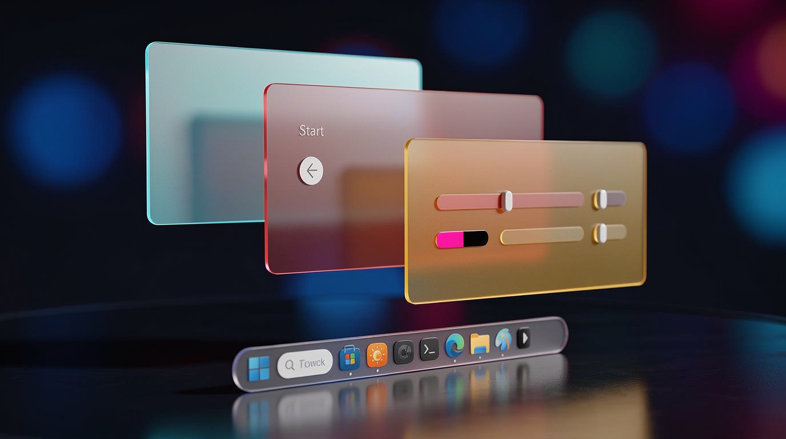

<p align="center">
  
</p>

# Glass Platform

Glass Platform меняет отрисовку Windows 10 и 11: прозрачность, стекло, общие цвета и мягкий свет в окнах, на панели задач, в меню «Пуск», в центре уведомлений и в контекстных меню.

Хост подключается к графическим процессам и подменяет отрисовку рамок, фонов, кнопок, полос прокрутки, всплывающих окон и текста: кисти, цвета, порядок закраски и эффекты материала. Окна, меню и ярлыки остаются теми же.

Glass Platform is experimental theming for Windows 10 and 11. It hooks GUI processes and replaces how controls and shell surfaces are painted. License: [GNU GPL v3](LICENSE).

## Что меняется

- **Окна и диалоги** — рамки и фоны в цвете рабочего стола.
- **Стандартные элементы** — кнопки, списки, комбобоксы, панели инструментов и прочие common controls в одном стеклянном стиле.
- **Панель задач** — полоса и её элементы рисуются по отдельным зонам.
- **Меню «Пуск», поиск и вылетающие панели** — в общей палитре с остальной оболочкой.
- **Центр уведомлений и календарь** — то же оформление.
- **Контекстные меню** — Win32 и часть меню на панели задач.
- **Рабочий стол** — пункт управления платформой в контекстном меню.
- **Проводник** — окна папок в одной палитре с остальной оболочкой.

Параметры задаются в **GlassSettings**. Включение и выключение — **LogViewer** или контекстное меню рабочего стола. Повседневная работа идёт через эти программы. Справочник ключей — [docs/registry.md](docs/registry.md).

## Прежде чем включать

Программа **экспериментальная**: инъекция в GUI-процессы, дополнительная нагрузка на CPU и GPU, без гарантии стабильности. После остановки возможны кратковременные артефакты в проводнике или других процессах, пока они не перерисуются. Не используйте на машине, где сбой или перезапуск оболочки недопустимы.

Подробнее о рисках и отказе от гарантии — [LICENSE](LICENSE).

## Запуск

- Windows 10 или 11. Основная сборка и запуск — x64; x86 собирается отдельно.
- Для старта хоста нужны права администратора.
- **Включение:** LogViewer → START, или `Rundll32.exe "путь\GlassCompat.dll",Main /start`.
- **Выключение:** STOP в LogViewer, `Main /stop`, или `stop.vbs` в каталоге сборки, если платформа уже запущена. Если сборка сообщает, что DLL занята, сначала остановите платформу штатно.
- **Параметры:** GlassSettings.exe. Пункт контекстного меню рабочего стола регистрируется оттуда.

Готового выпуска нет: платформу собирают из исходников. Установщик описан в [GlassSetup/README.md](GlassSetup/README.md); известное падение Explorer при обновлении остаётся открытым дефектом. Переключатель SecureUxTheme в GlassSettings включает и выключает только регистрацию IFEO/COM. Удаление продукта и оставшиеся файлы ThemeUiProxy описаны там же; перевод GlassUnins на оригинальный ProductCode ещё в работе.

## Сборка

Нужен Visual Studio 2022. Заголовки библиотеки [gtl](https://github.com/greg7mdp/gtl) положите в каталог `gtl` в корне решения, рядом с `GlassProject.sln`. Сборка читает оттуда `phmap.hpp` (`gtl\phmap.hpp`). Каталог в репозиторий не входит. Каталог `tools` тоже локальный и на GitHub не публикуется.

```bat
msbuild GlassProject.sln /p:Configuration=Debug /p:Platform=x64
```

Результат: `Build\x64\Debug\`.

Сборка установщика, порядок Release x64 → x86, откат и журналы — [GlassSetup/README.md](GlassSetup/README.md).

## Подпись

Официальные Release-сборки подписаны сертификатом **`CN=Stanislav K.`**. Сейчас это временный self-signed сертификат. SmartScreen и UAC показывают «Неизвестный издатель»: подпись подтверждает авторство и целостность файла. Для self-signed `Status` будет `UnknownError` с сообщением о недоверенном корне — при совпавшем отпечатке подпись цела.

| | |
|---|---|
| Subject | `CN=Stanislav K.` |
| SHA-1 thumbprint | `A801E5F5F430D6D19164C856F79B8EFD23F83EB8` |
| SHA-256 fingerprint | `1295F4BD2E1E7D710B380ECE573E8C3C021AE1E21C0E77174E5307E68A7DC93D` |
| Публичный сертификат | `Shared/certs/DeveloperCodeSigning.cer` |
| Действителен | 2026-11-01 .. 2031-11-01 |
| Подписаны сборки | начиная с сборок от 2026-11-01 |

- Отпечаток совпал с таблицей — файл авторский, подпись цела.
- `HashMismatch` — файл изменён после подписи.
- `NotSigned` — файл не из авторской сборки.

В двух последних случаях файл запускать не следует. Устанавливать `.cer` в доверенные корневые центры не нужно. Что именно подписано, команда проверки и режимы сборки — [docs/signing.md](docs/signing.md).

## Состав

| Модуль | Роль |
|--------|------|
| GlassCompat.dll | Хост: WinEvent, инжекция, остановка |
| GlassCore.dll | Перехват отрисовки, темы, диспетчер paint |
| WndCompat.dll | Подклассы и окна приложений |
| ExplorerCompat.dll | Проводник |
| TaskbarCompat.dll | Панель задач |
| UICompat.dll | CoreWindow / «Пуск», поиск, NC |
| GlassSettings.exe | Параметры |
| LogViewer.exe | Управление и журнал (только в Debug) |
| GlassShellSparse\GlassShellExt.dll | Контекстное меню рабочего стола (вместе с `GlassShellHost.exe` и sparse-пакетом в подкаталоге `GlassShellSparse\`) |
| GlassSetup.exe | Установщик платформы |

## Документация

- Архитектура: [ARCHITECTURE.md](ARCHITECTURE.md)
- Сборка модулей и правила для разработчиков: [AGENTS.md](AGENTS.md), README каталогов `GlassCore/`, `GlassCompat/`, `GlassSettings/` и остальных проектов
- Реестр: [docs/registry.md](docs/registry.md)
- Установщик: [GlassSetup/README.md](GlassSetup/README.md)
- Подпись: [docs/signing.md](docs/signing.md)

## Связанные проекты

Облик частично вдохновлён [TranslucentFlyouts](https://github.com/ALTaleX531/TranslucentFlyouts). Установщик по желанию кладёт [OpenGlass](https://github.com/ALTaleX531/OpenGlass) в каталог Glass. Glass Platform продолжает BlackWindowManager. Совместная работа не поддерживается: ключ `Software\StanislavKa\BlackWindowManager` не читается и не пишется, значения из него сами не переносятся.
