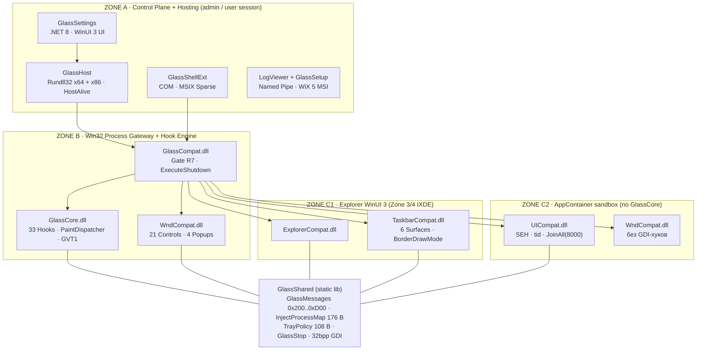

# 01 · Обзор 13 модулей и граф границ доверия

Каждый компонент собран в изолированную DLL или исполняемый хост **без статической
линковки между peer-DLL**: межмодульные вызовы и передача владения происходят строго
через явные C-экспорты, `GetModuleHandleW`, `Shared::GlassStop` и разделяемую память ядра.

**INSPECT.** На сайте по узлам этой схемы можно ходить кликом и переключать
плоскости; здесь доступны три подграфа — Control Plane, Win32 Gateway и Win11 IXDE.

## Таблица модулей решения

| Модуль | Артефакт / контекст | Зона ответственности |
|---|---|---|
| `GlassHost` | `Rundll32.exe` (x64 + x86) | Двухархитектурный хост: `WH_CBT`/`WH_CALLWNDPROC`, `HostAlive`, `InjectProcessMap.v2` |
| `GlassCompat` | `GlassCompat.dll` | Gate R7, CoreWindow-ветвление, ленивая загрузка Win11 DLL, `ExecuteShutdown` |
| `GlassCore` | `GlassCore.dll` | 33 `*Hooks.cpp`, `IATRegistry`, `PaintDispatcher` (4 канала), `GlobalTextGlow`, `GVT1` |
| `WndCompat` | `WndCompat.dll` | `WindowClassifier`, `GlassAttachGate`, 21 контрол и 4 перехватчика popup/меню |
| `ExplorerCompat` | `ExplorerCompat.dll` | Win11 WinUI 3 IXDE (Zone 3/4 Explorer), `RestoreExplorerChrome` при выгрузке |
| `TaskbarCompat` | `TaskbarCompat.dll` | Панель и смежные XAML-поверхности, `BorderDrawMode` 0/1, `SeparateZones`, `CornerType 0..5` |
| `UICompat` | `UICompat.dll` | Изоляция `AppContainer`, `tid`-фильтрация IXDE, PLM thaw, `TrayXamlPolicy.v4` (108 B) |
| `GlassShared` | Static Lib (`.lib` / `.h`) | `GlassMessages`, `InjectProcessMap.h`, `TrayXamlPolicyMap.h`, `Shared::GlassStop`, 32bpp GDI |
| `GlassShellExt` | COM + `GlassShellSparse` | Контекстное меню проводника; MSIX Sparse Package / `regsvr32` |
| `GlassSettings` | .NET 8 / WinUI 3 | Настройки в `HKCU`, импорт `.glassbackup v2`, `NoBackdrop=1` |
| `LogViewer` | C# / Named Pipe UI | Журналы процессов в реальном времени по именованному каналу |
| `GlassSetup` | WiX MSI + Bootstrapper | 5 MSI-пакетов в едином установщике, проверка подписи |
| Native Tests | C++ Console | `IATRegistry`, маски альфа-канала, разметка разделяемой памяти |

Источник: [docs.html · раздел 01](https://glass-platform.ru/docs.html) · далее → [02 · Инициализация и ветвление](02-init)
