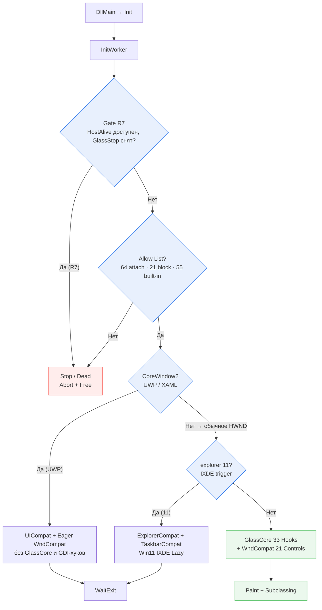

# 02 · Вход в процесс, Gate R7 и CoreWindow-ветвление

Когда Win32-хук доставляет `GlassCompat.dll` в целевой процесс, система не инжектирует
весь графический стек слепо. Поток инициализации проходит через проверку остановки
(`R7`), фильтрацию списков процессов (64 `kAttachList` / 21 `kBlockList`) и строгую
классификацию: в `CoreWindow`-хосты **`GlassCore.dll` не загружается никогда**.

Фильтры по веткам («Все ветки / Обычный Win32 / Win11 explorer / CoreWindow / Stop»)
на сайте интерактивны; здесь роль ветки видна по цвету узла.

**R7-гейт перед стартом.** Нативный приёмник в `InitWorker` проверяет доступность
`HostAlive.<arch>` и отсутствие сигнала `GlassStop` до открытия любых графических
дескрипторов — это исключает гонки при закрытии хоста.

**Почему CoreWindow пропускает `GlassCore`.** В `ShellExperienceHost`,
`StartMenuExperienceHost` и `SearchHost` строгая песочница `AppContainer` и
DComp-композиция XAML несовместимы с GDI/UXTheme-хуками `GlassCore`. Туда грузятся
только `UICompat` и `WndCompat`.

Источник: [docs.html · раздел 02](https://glass-platform.ru/docs.html) · ← [01](01-overview) · → [03](03-hooks-pipeline)
