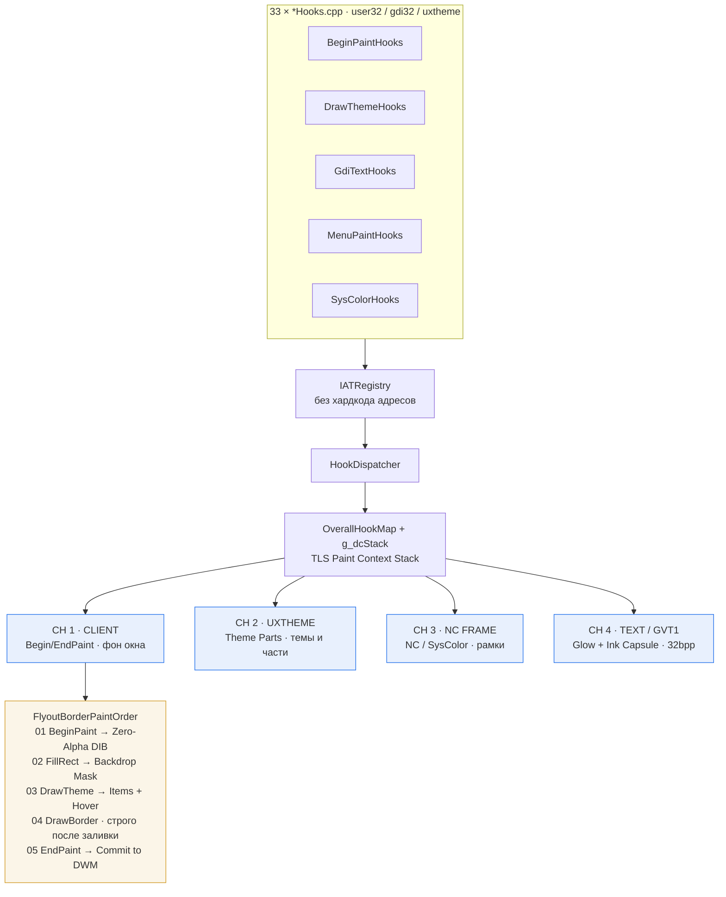

# 03 · 33 модуля перехвата, IATRegistry и 4-канальный PaintDispatcher

`GlassCore.dll` содержит **33 файла `*Hooks.cpp`** (`BeginPaintHooks`, `DrawThemeHooks`,
`GdiTextHooks`, `MenuPaintHooks`, `SysColorHooks` и др.). Каждый перехват регистрируется
в `IATRegistry` без хардкода адресов, поддерживая безопасный 4-уровневый стек наложения
и диспетчеризацию `HDC`.

## Стек `IATRegistry` (4 слота)

На сайте — интерактивный симулятор; в вики — таблица эквивалентна по смыслу.

| Слот | Владелец | Поведение |
|---|---|---|
| 0 | Base · Original System API | Исходный `user32!BeginPaint`, вызывается последним |
| 0→1 | `GlassCore` | Активный владелец перехвата, рисует стекло |
| 1→2 | `WndCompat` | Сабклассинг контролов, поверх GlassCore |
| 2→3 | 3rd-Party | Внешний перехватчик; `Unhook Top` снимает только верхний слот |
| 3 | Свободен | Больше 4 слоёв не накладывается — защита от циклов |

Регистрация симметрична: `Push(GlassCore)` → `Push(WndCompat)` → `Push(3rd-Party)`,
снятие — строго с вершины (`Unhook Top`) либо полный `Reset` при выгрузке.

**Критический шаг.** `DrawBorder` в `FlyoutBorderPaintOrder` (шаг 04) обязан
выполняться **после** заливки фона: иначе DWM-композиция перезапишет рамку меню.

Источник: [docs.html · раздел 03](https://glass-platform.ru/docs.html) · ← [02](02-init) · → [04](04-gdi-32bpp)
