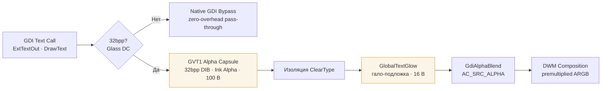

# 04 · Конвейер 32bpp, свечение текста и капсула GVT1

Исторический GDI сбрасывает 4-й байт цвета (α) в `0x00`, из-за чего DWM воспринимает
текст и кисти на стекле как абсолютно прозрачные. `GlassCore` оборачивает текстовые и
графические вызовы в 32bpp premultiplied DIB-буферы с капсулой **`GlassInkAlphaCapsule`
(`GVT1`)**.

**Преумноженная альфа (`AC_SRC_ALPHA`).** Обычный `BitBlt` затирает альфа-байт нулём.
Все кисти, иконки и фоновые градиенты приводятся к формату `(R·α, G·α, B·α, α)` через
`Shared::GdiAlphaBlend`.

**`GlobalTextGlow`.** Под текстом заголовков и панели навигации рендерится мягкий ореол
без цветного «мусора» ClearType; яркость ореола вычисляется от яркости фона.
Параметр — `DarkMode_GlobalTextGlow`, `REG_BINARY` 16 байт.

**`GlassInkAlphaCapsule` (`GVT1`).** `REG_BINARY` 100 байт: цвет, альфа-границы и режим
слияния чернил, применяемые к тексту на стекле.

Источник: [docs.html · раздел 04](https://glass-platform.ru/docs.html) · ← [03](03-hooks-pipeline) · → [05](05-window-classifier)
