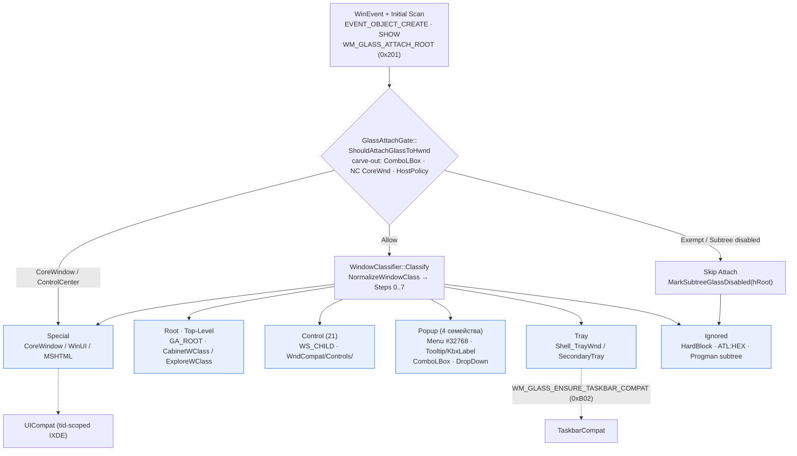

# 05 · `GlassAttachGate`, 6 ролей `WindowClassifier` и 21 + 4 обработчика

`WndCompat.dll` классифицирует и обрабатывает окна Win32, WinForms, ATL/WTL и
XAML-мосты. Первичный фильтр `GlassAttachGate::ShouldAttachGlassToHwnd` отсекает
освобождённые от стекла поддеревья (`IsHwndBackdropExempt` / `IsSubtreeGlassDisabled`),
после чего 8-шаговый `WindowClassifier::Classify` распределяет `HWND` по 6 ролям
`WindowRole` и выбирает стратегию крепления: `*Subclass` (`SetWindowSubclass`) или
`*Host` (без сабклассинга).

## Шаги `WindowClassifier::Classify`

| Шаг | Проверка | Результат |
|---|---|---|
| 0 | `CoreWindow` / `ControlCenter` | `Special` (UWP-хосты) |
| 1 | `IsHardBlockedClass` · `ATL:HEX` · HostPolicy | `Ignored` |
| 2 | `Shell_TrayWnd` / `Progman` subtree | `Tray` |
| 3 | Popup: `#32768`, Tooltip | `Popup` |
| 4 | `Special` · `NetUiToolWindow` | `Special` |
| 5 | `WS_CHILD` | `Control` (21) |
| 6 | Soft-blocked (`GA_ROOT` есть) | `Control`, стратегия `*Host` |
| 7 | `GA_ROOT` | Explorer / Native top-level |

Выход: `{ WindowRole, ControlKind }`; далее `ControlKind` уточняется до 11 вариантов
`WinForms_*` и 4 `Atl/Wtl`.

## Стратегии крепления

- **18 `*Subclass`** — `SetWindowSubclass` на родном UI-потоке.
- **5 `*Host`** без сабклассинга: `ScrollBar` · `TrackBar` · `UpDown` · IE · Tray.

Выгрузка (2026-09): `PostMessage(WM_GLASS_DETACH_*)` → `RemoveWindowSubclass` на родном
потоке → `Wait(INFINITE)` → `g_hookInstalled = false` → `ScanStaleCallbacksBeforeFree` (H91).
`SendMessage` при отвязке запрещён — риск deadlock.

**SAFETY.** `g_hookInstalled` сбрасывается **только после** `WaitForSingleObject(INFINITE)`,
а `GlassCompat` перед `FreeLibrary` запускает проверку «зависших» колбэков.

Источник: [docs.html · раздел 05](https://glass-platform.ru/docs.html) · ← [04](04-gdi-32bpp) · → [06](06-win11-xaml)
