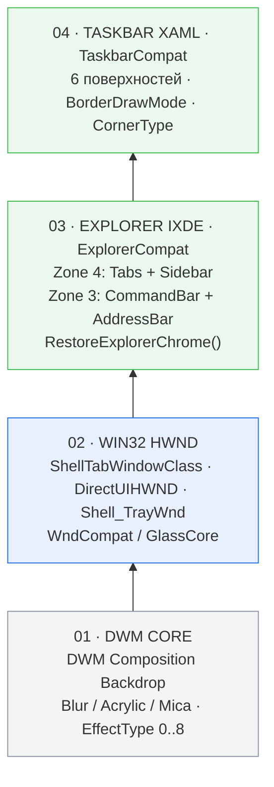

# 06 · Explorer WinUI 3 IXDE (Zone 3/4) и 6 поверхностей TaskbarCompat

С Windows 11 адресная строка, вкладки Проводника и вся панель задач рисуются внутри
XAML Islands через `Microsoft.UI.Xaml` и DirectComposition (**IXDE**). `ExplorerCompat`
находит непрозрачные кисти в визуальном дереве (Zone 3/4), а `TaskbarCompat` управляет
6 поверхностями панели задач, режимом рамок и скруглением.

На сайте этот блок — интерактивный **3D-стек** в аксонометрии с переключением
«Разнесённый / Собранный». Mermaid не умеет изометрию, поэтому здесь тот же порядок
композиции передан стрелками от фронта к тылу (снизу вверх).

## 6 поверхностей `TaskbarCompat`

| Поверхность | Содержимое |
|---|---|
| Widgets | виджеты слева |
| Start / TaskList | кнопка Пуск и список задач |
| SystemTray + Overflow | трей, часы, скрытые значки |
| Preview | превью задач (`LivePreview`) |
| Menu | контекстные меню панели |
| Tooltip | всплывающие подсказки |

## Режимы отрисовки

| Параметр | Значения | Смысл |
|---|---|---|
| `Tray\BorderDrawMode` | `0` — DWM / SWCA, `1` — XAML | кто рисует рамку панели |
| `Tray\Xaml\SeparateZones` | `0` — слитная, `1` — 3 зоны | разделение фона на зоны |
| `Tray\Xaml\CornerType` | `0..5` | 0 — системные 0 px, 1 — прямые, 2 — 8 px `ROUND`, 3 — 4 px `ROUNDSMALL`, 4 — 16 px (XAML only), 5 — `h/2` (pill) |

`kIncreasedCornerRadiusDip = 16`, `MaxRound = h/2`, `kZonePadXMaxRound = 12`.
Симулятор панели задач с живым переключением этих трёх параметров есть только на сайте.

Источник: [docs.html · раздел 06](https://glass-platform.ru/docs.html) · ← [05](05-window-classifier) · → [07](07-appcontainer)
