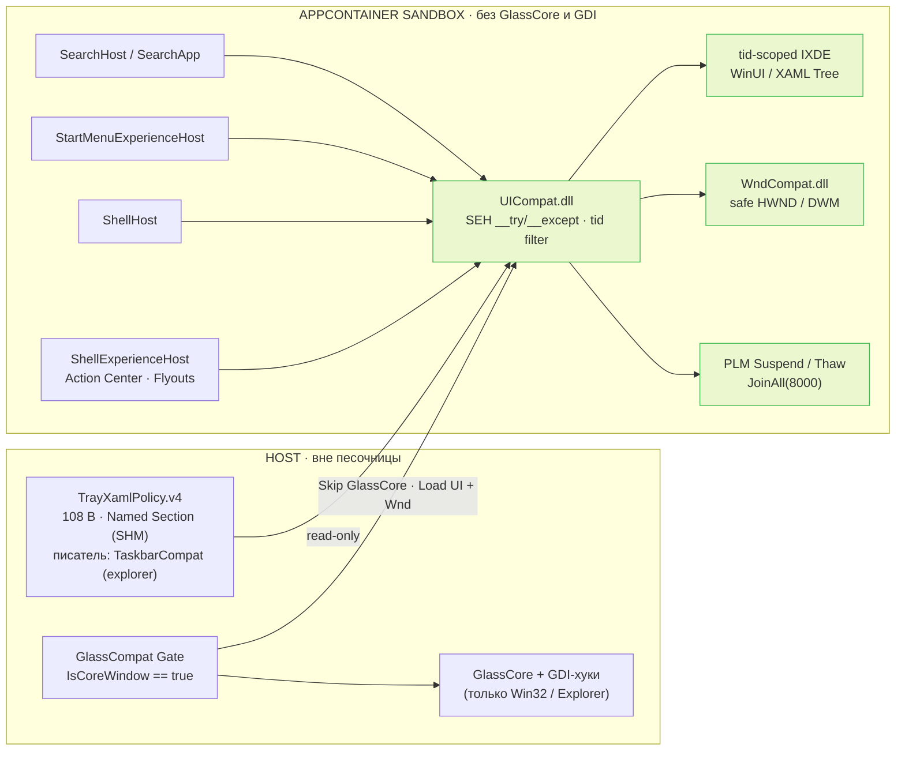

# 07 · UICompat: AppContainer, PLM и `TrayXamlPolicy`

Системные хосты Windows (`StartMenuExperienceHost`, `SearchHost`, `ShellExperienceHost`,
`ShellHost`) работают под строгой изоляцией `AppContainer` и приостанавливаются
менеджером жизненного цикла (**PLM Suspend / Thaw**). `UICompat` использует SEH-блоки,
фильтрацию по идентификатору потока (`tid`) и жёсткий лимит `ModuleThread::JoinAll(8000)`.

**All-or-Nothing.** `TrayXamlPolicy.v4` пишется снаружи (из `explorer.exe`) и читается
внутри песочницы read-only, а любой C++/COM сбой перехватывается SEH — необработанное
исключение в `AppContainer` означает падение системного хоста.

**Зачем политика.** `TrayXamlPolicy.v4` (108 B, секция с DACL `WD+AC`) даёт точное
совпадение границ и радиуса углов внутри `AppContainer` с тем, что рисует
`TaskbarCompat` снаружи: XAML-поверхности не могут прочитать `HKCU` напрямую, поэтому
цвет, прозрачность и радиус передаются через разделяемую память.

**PLM.** При сворачивании всплывающего центра хост замораживается; `UICompat`
пережидает `Suspend` и повторно применяет кисти при `Thaw`, не сбрасывая системные
значения панели задач.

Источник: [docs.html · раздел 07](https://glass-platform.ru/docs.html) · ← [06](06-win11-xaml) · → [08](08-ipc)
