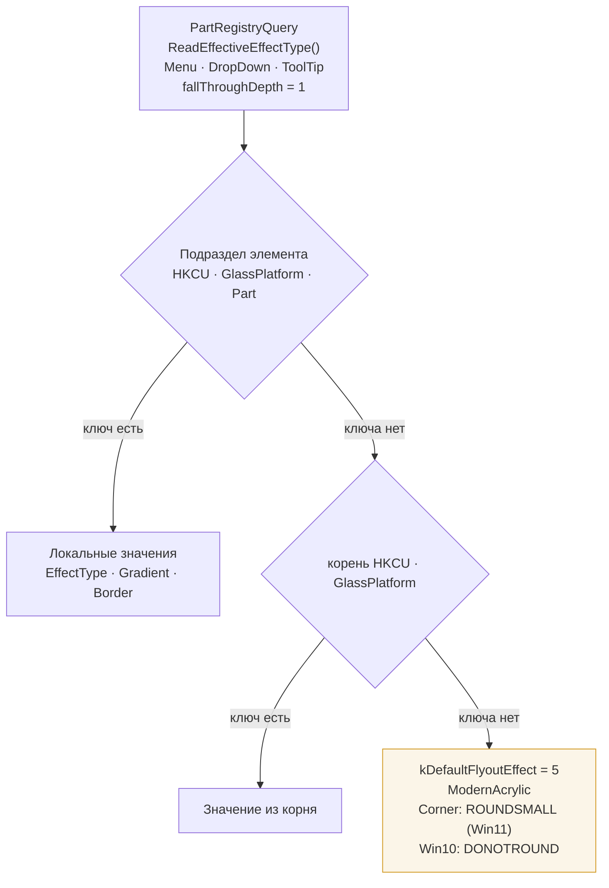

# 09 · Иерархия реестра, резолвер политик и спектр `EffectType 0–8`

Настройки хранятся в ветке текущего пользователя
`HKCU\Software\StanislavKa\GlassPlatform`. `HKLM` используется только как запасная
ветка для `InstallPath` и бинарных параметров свечения текста; из `AppContainer`
чтение идёт через `RealUserReg` / `TrayXamlPolicy.v4`.

Для разных типов окон работают разные резолверы: `PartRegistryQuery`
(`Menu` / `DropDown` / `ToolTip`), `RootPolicyQuery` + `RootSwcaRegistryQuery`
(`Root\Active` / `Root\Inactive`) и `TrayXamlPaint` (`Tray\Xaml\*`).



## `EffectType 0..8`

| ET | Название | API |
|---|---|---|
| 0 | Отключить | — |
| 1 | Прозрачный | SWCA `ACCENT_POLICY` |
| 2 | Сплошная | SWCA |
| 3 | Размытие | SWCA |
| 4 | Классический акрил | SWCA |
| 5 | Современный акрил | SWCA + `MODERN_ACRYLIC_RECIPE` (`AccentFlags |= 1<<1`) |
| 6 | Акрил (DWM) | `DWMWA_SYSTEMBACKDROP_TYPE` (Win11 22621+) |
| 7 | Mica | DWM, без `GradientColor` |
| 8 | Mica Alt | DWM, без `GradientColor` |

`GradientColor` — ABGR. Если `root = OpenGlass (DWM)`, а для popup выбран ET `6..8`,
`SwcaBackdrop.cpp` автоматически переключается на SWCA Modern Acrylic, чтобы не
получить прозрачную «дырку». Для XAML-панели задач своя шкала
`Tray\Xaml\EffectType`: 0 Отключить, 1 Прозрачный, 2 Сплошная, 3 Размытие, 4 Акрил,
5 Системный.

## Дерево ключей

```
HKCU\Software\StanislavKa\GlassPlatform
├── EffectType                  (REG_DWORD: 0..8)
├── DarkMode_GradientColor      (AARRGGBB; не при 6..8)
├── DarkMode_BorderColor        (AARRGGBB; NoBorderColor=1)
├── DarkMode_GlobalTextGlow     (REG_BINARY: 16 B)
├── GlassInkAlphaCapsule        (REG_BINARY: GVT1, 100 B)
├── Menu\ · DropDown\ · ToolTip\ (подразделы Popup + Animation\)
├── Root\
│   ├── NoBackdrop              (1 = откл. backdrop)
│   ├── SeparateActiveInactive  (Active\ · Inactive\)
│   ├── CornerType              (0..3) · Control\{Ribbon..Static}
│   └── …
├── Tray\
│   ├── BorderDrawMode          (0=DWM/SWCA, 1=XAML)
│   └── Xaml\ (SeparateZones, CornerTypeSchema=3, Popup/Preview/Menu/Tooltip)
└── AttachList\ · BlockList\ · DisabledList\ · GlassSettings\
```

**LIVE.** Запись в реестр сама картинку не обновляет. Live-правка и «Сохранить» в
`GlassSettings` рассылают `WM_THEMECHANGED` (`0x031A`) для текстуры/материала/атласа и
`WM_DWMCOLORIZATIONCOLORCHANGED` (`0x0320`, `NotifyDwmColorizationChanged`) для цвета,
прозрачности и blur.

Полный справочник параметров с таблицами перекрытий Popup/Root/Menu/ToolTip/Tray —
[registry.html](https://glass-platform.ru/registry.html).

Источник: [docs.html · раздел 09](https://glass-platform.ru/docs.html) · ← [08](08-ipc) · → [10](10-unload)
