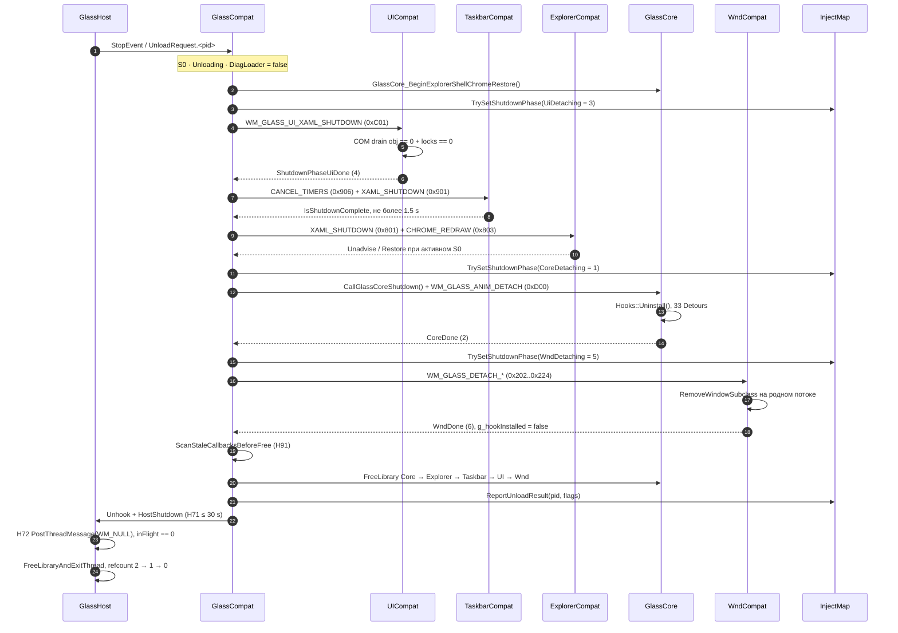

# 10 · Детерминированная выгрузка `ExecuteShutdown()` (S0 + фазы 1–6)

Выгрузка инжектированных DLL во время работы UI-потоков — самый критичный участок
архитектуры. С сентября 2026 года `GlassCompat::ExecuteShutdown()` использует
event-based координацию (`PostMessage` + `WaitForSingleObject(INFINITE)`, без
блокирующего `SendMessage`) и строгий порядок демонтажа
**S0 → UICompat → TaskbarCompat → ExplorerCompat → GlassCore → WndCompat →
FreeLibrary + H71/H72 + FLAET**, фиксируя `ShutdownPhase (1..6)` и `UnloadResult`
в `InjectProcessMap`.

## Порядок фаз и почему он такой

| Фаза | Модуль | Барьер / защита |
|---|---|---|
| **S0** | `explorer.exe`: `BeginExplorerShellChromeRestore()` | `explorerframe` `ExtendFrame/DWM` → passthrough, пока XAML-поверхности активны |
| 1–4 | `UICompat` (3 → 4) | `WM_GLASS_UI_XAML_SHUTDOWN` на STA IXDE, COM drain `obj == 0 && locks == 0` (≤ 5 s), `IsComplete` ≤ 1.5 s |
| 2 | `TaskbarCompat` | `CANCEL_TIMERS` + `XAML_SHUTDOWN`, `RestoreAllFills`, `UnadviseWait`; строго **до** `ExplorerCompat` |
| 3 | `ExplorerCompat` | `XAML_SHUTDOWN` + `CHROME_REDRAW` на STA, до снятия `GlassCore` |
| 4 | `GlassCore` (1 → 2) | `CallGlassCoreShutdown()` под SEH H54, `WM_GLASS_ANIM_DETACH` + `Wait(∞)`, `Hooks::Uninstall()` 33 Detours |
| 5–6 | `WndCompat` (5 → 6) | `PostMessage(WM_GLASS_DETACH_*)` → `RemoveWindowSubclass` → `Wait(∞)` → `g_hookInstalled = false` |
| 6 | `FreeLibrary` + H71/H72 | H91 `ScanStaleCallbacksBeforeFree`, затем `FreeLibrary` (Core → Explorer → Taskbar → UI → Wnd); H71 `Wait` ≤ 30 s на ранний `HostShutdown`, H72 `PostThreadMessage(WM_NULL)` при `inFlight == 0` |

**Межмодульная зависимость.** `CHROME_REDRAW` в `ExplorerCompat` обязателен **после**
S0: иначе после выгрузки XAML окно Проводника останется с артефактом рамки.

На сайте фазы кликабельны (S0…6) с описанием действия и IPC — там же полный граф
возвратов.

Источник: [docs.html · раздел 10](https://glass-platform.ru/docs.html) · ← [09](09-registry) · → [11](11-tools)
