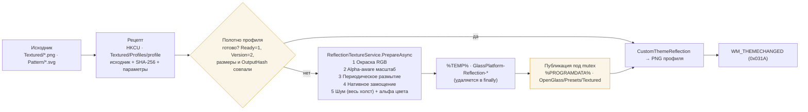

# 13 · Формирование текстур стекла OpenGlass: PNG-плитки, SVG и генерация полотна

Исходные отражения хранятся в пакете **OpenGlass Resources**
(`OpenGlass/Resources/GlassReflection`), но в DWM передаётся не крошечная плитка, а
полноразмерное straight BGRA PNG-полотно под виртуальный рабочий стол (размер — из
снимка мониторов), которое `GlassSettings` формирует в
`%PROGRAMDATA%\OpenGlass\Presets\Textured\<profile>.png`.

Каталоги исходников:

| Категория Pivot | Каталог | Принцип генерации полотна |
|---|---|---|
| **Текстуры** | `Textured/*.png` | минимальная RGBA-ячейка замощения, нарисованная чёрным: узор в альфа-канале. При 100 % копируется в нативных пикселях без растяжения; правый/нижний край — частичный повтор |
| **Рисунок** | `Pattern/*.svg` | векторная композиция `1920×1080`, `preserveAspectRatio="none"`, растеризация `SVG.NET 3.4.7`; масштаб от центра с прозрачными полями |
| **Другие** | корень `GlassReflection` | готовые растровые картинки passthrough, без генератора и диалога «Настроить» |

## Профиль экрана и синхронизация

Профиль — ключ `<width>x<height>_DPI<first>_<16 hex>`, посчитанный из полных
прямоугольников и DPI мониторов; порядок и физические ID на ключ не влияют.
Готовое полотно: PNG, у которого `Ready=1`, `Version=2`, размеры совпадают с профилем,
а SHA-256 файла равен `OutputHash` из рецепта.

| Состояние | Действие |
|---|---|
| Полотно готово и уже применено | **None** |
| Полотно готово, применено другое (наш PNG другого профиля или чужое) | **Adopt** |
| Полотна нет, применён наш PNG, рецепт пригоден | **Regenerate** |
| Полотна нет, применён наш PNG, рецепта нет или исходник пропал | **Clear** |
| Ничего не применено, полотна нет | **None** |
| Применено чужое изображение, полотна нет | **None** (чужой выбор не перезаписывается) |

Платформенный хелпер следует той же таблице, но рендера в нём нет: в состоянии
**Regenerate** он только снимает устаревшее значение, полотно строит `GlassSettings`.

## Шум и лимиты

Каждый узор поставляется одним файлом, нарисованным чёрным (`#000000`): рисунок целиком
в альфа-канале. Генератор заменяет RGB выбранным цветом и сохраняет альфу; слой шума
накладывается **после** замощения как детерминированное ахроматическое поле
`g ∈ [−1, 1]` в режиме `source-over` (straight BGRA).

| ID | Тип зерна | Распределение |
|---|---|---|
| `−1` | Без шума | пропуск генерации при любых значениях полей |
| `0` | Мягкое | интерполяция равномерного поля, шаг `2 px` |
| `1` | Плёночное | масштабы `2 px` и `1 px`, Box–Muller с ограничением `±2.5σ` |
| `2` | Точечное | круглые зёрна в сетке `3 px`, субпиксельное покрытие `2×2` |
| `3` | Блочное | квадратные фракции `2×2 px` без размытия границ |
| `4` | Мелкозернистое | независимые пиксели 6 яркостей, `σ ≈ 52.83` |

Растеризатор `SVG.NET 3.4.7` принимает только белый список (контуры, фигуры, группы,
градиенты, `clipPath`); запрещены DTD, CSS, скрипты, шрифты, `image`, `use/href`,
фильтры. Лимиты: `256 KiB`, 512 элементов, глубина 32; лимит холста — `16384 px` /
33 554 432 px². В OpenGlass всегда уходит готовый PNG, не SVG.

Для записи в общий каталог `Presets\Textured` нужны права **Modify**; установщик
OpenGlass Resources их не выдаёт, reparse points отвергаются, при чтении рецепта
проверяется SHA-256 результата.

Источник: [docs.html · раздел 13](https://glass-platform.ru/docs.html) · ← [12](12-build-signing) · [Главная](Home)
