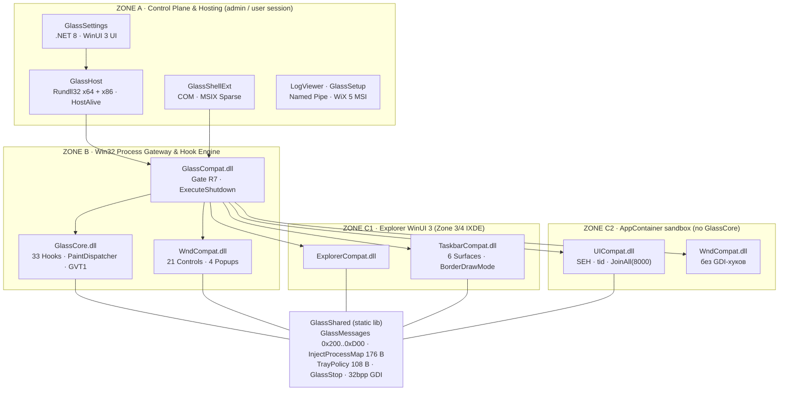
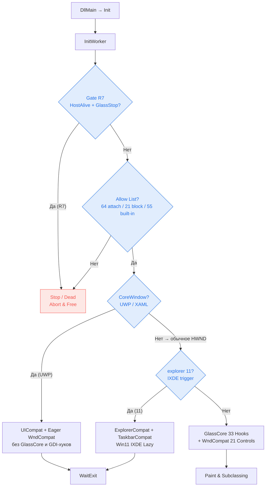
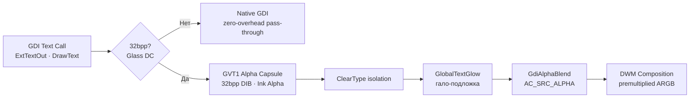
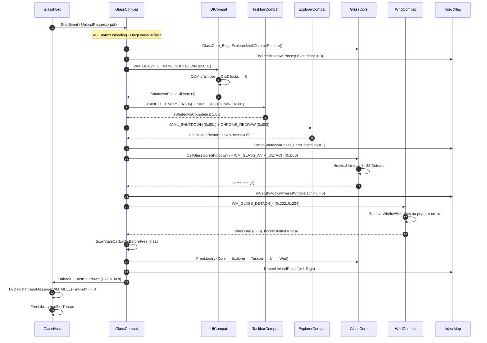

# GlassPlatform · техническая документация (черновик wiki)

> Черновик страницы для GitHub Wiki. Диаграммы ниже — рабочий пример переноса
> интерактивных схем с [glass-platform.ru/docs.html](https://glass-platform.ru/docs.html)
> на встроенный в GitHub Mermaid. Публикация: см. [README](README.md).

## 1 · Обзор 13 модулей и граф границ доверия

Диаграмма зон повторяет блок `ARCHITECTURE` сайта: переключатели плоскостей
(Control Plane / Win32 / Win11 IXDE) заменены тремя подграфами `subgraph`.

## 2 · Вход в процесс, Gate R7 и CoreWindow-ветвление

Блок `FLOWCHART` сайта (`GlassCompat::DoInitialize()`). Фильтры по веткам
(«Все ветки / Обычный Win32 / CoreWindow / Stop») в wiki невозможны — вместо них
отдельные свёрнутые блоки `
` или подсветка роли цветом узла.

## 3 · Конвейер 32bpp и капсула GVT1

Блок `DATA FLOW`: 24/32bpp → DIB → `GlobalTextGlow` → `GdiAlphaBlend` → DWM.

## 4 · Чистая выгрузка: `ExecuteShutdown()` (S0 + фазы 1–6)

Блок `SEQUENCE` с навигацией по фазам. В Mermaid порядок фаз передаётся
`Note over`, а межмодульные барьеры (`WaitForSingleObject(INFINITE)`) — пунктирными
возвратами `-->>`.

## Что переносится, а что нет

| Блок сайта | В wiki | Комментарий |
|---|---|---|
| Архитектура 13 модулей | ✅ Mermaid `flowchart` + `subgraph` | Переключатели плоскостей → подграфы |
| `DoInitialize` FLOWCHART | ✅ Mermaid `flowchart TD` | Фильтры ветвей → `
` / `classDef` |
| IAT / PaintDispatcher PIPELINE | ✅ Mermaid `flowchart LR` | 4 канала — 4 ветки |
| GVT1 DATA FLOW | ✅ Mermaid `flowchart LR` | Полностью воспроизводимо |
| WindowClassifier CLASSIFICATION | ⚠️ частично | 8 шагов и 6 ролей — `flowchart`; интерактивный выбор роли — нет |
| LAYER STACK 3D (Explorer / Taskbar) | ❌ | Изометрии в Mermaid нет → статический SVG/PNG |
| UICompat COREWINDOW | ✅ Mermaid `flowchart` + `subgraph` | Граница AppContainer — `subgraph` |
| `ExecuteShutdown` SEQUENCE | ✅ Mermaid `sequenceDiagram` | 8 акторов читаемо, но шире, чем на сайте |
| SIMULATOR: IATRegistry, Taskbar corners | ❌ | Нужен JS → только сайт |
| Дерево реестра (ASCII-блок) | ✅ | Код-блок без изменений |

Ограничения GFM на GitHub: нет `<script>`, `<style>`, `iframe`, атрибутов
`style`/`onclick`; Mermaid рендерится с отключёнными кликами и не переопределяет
тему. Подробности публикации — в [README](README.md).
